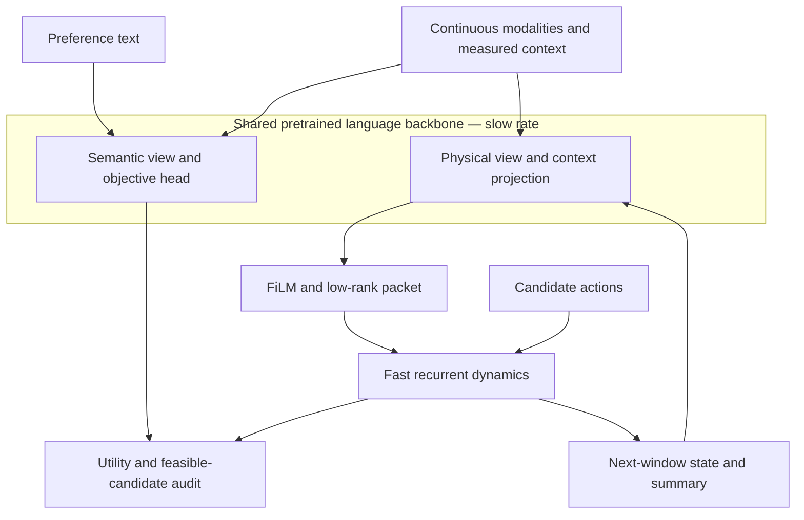

# 6G-MR-NWM

**A multi-rate world-model research component for 6G Agentic RAN.**

This repository studies how a multimodal world model can support RAN agents with
causal state forecasts and comparable evaluation of candidate radio actions. The
pretrained-language-model path and the lightweight synthetic reference path are
research components; this repository does not implement a complete Agentic RAN
orchestrator, a RIC/E2 integration, or a live radio-control loop. The proposed
system architecture and implementation boundaries are documented in the
[Chinese Agentic RAN technical report](docs/AGENTIC_RAN_TECHNICAL_REPORT_CN.md).
Authors are blank in the manuscript and PDF metadata.

[Paper (PDF)](paper/main.pdf) · [LaTeX source](paper/main.tex) ·
[中文论文要点（3–5 分钟）](docs/OVERVIEW_CN.md) ·
[中文 Agentic RAN 技术报告](docs/AGENTIC_RAN_TECHNICAL_REPORT_CN.md) ·
[中文进展报告](docs/PROGRESS_REPORT_CN_2026-10-23.md) ·
[架构与多时间尺度详解](docs/ARCHITECTURE_CN.md) ·
[公开免费真实数据集](docs/REAL_DATASETS_CN.md) ·
[基站规划器动作设计](docs/PLANNER_ACTIONS_CN.md) ·
[规划器代码、运行与验证](docs/PLANNER_IMPLEMENTATION_CN.md) ·
[公开动作数据核查与训练方案](docs/PLANNER_ACTIONS_AND_DATA_CN.md) ·
[Measured results](results/SUMMARY.md) · [Review and corrections](docs/REVIEW.md) ·
[Reproduction protocol](docs/REPRODUCIBILITY.md) ·
[Current code review](docs/REVIEW_2026_10.md)

## Research status

There are two world-model code paths, plus separate real-measurement Stage-A
forecasting runs:

| Path | Backbone / model | Evidence |
|---|---|---|
| `LanguageBasedWorldModel` in `foundation.py` | External pretrained language transformer and tokenizer | Multimodal, gradient, causality and API integration checks; no trained RAN performance claim |
| `MultiRateNestedWorldModel` in `model.py` | Small randomly initialized attention/MLP mixture | Committed three-seed, eight-variant two-link synthetic benchmark |
| UC6 and UCC 5G Stage-A runs | Separate 19,344-parameter LSTM forecasters | Three-seed, eight-second-history/four-second-horizon forecasts against persistence; both datasets lack control-action logs |

The paper's original benchmark numbers belong **only to the synthetic lightweight
reference path**. Separate Stage-A results on public 5G measurements are
observation forecasts; they do not establish action-conditioned RAN control value.
No deployed RIC/E2 integration or live radio-control loop is included. The
pretrained language-model adapters and wireless heads still need task-aligned
training. Radio deadlines must be measured on the target system.

See [language-foundation inputs and timescales](docs/LANGUAGE_FOUNDATION.md).

The paper now distinguishes action-conditioned dynamics, a search-based planner,
and an optional learned policy, and defines a bounded RAN action contract.
The standalone [planner action design](docs/PLANNER_ACTIONS_CN.md) specifies
action families, control ownership, execution records, and acceptance criteria.
Public beam-selection labels and Colosseum resource/scheduler configurations
provide restricted supervision, with RF-emulator evidence kept separate from
field measurements. The [action-data audit](docs/PLANNER_ACTIONS_AND_DATA_CN.md)
records two actual CSV inspections, coverage limits, and a proposed simulation
protocol. The additive `BoundedPlanner` now implements finite-horizon search,
explicit action constraints/masks, and independent candidate rollouts. A separate
two-slice fluid-queue demo exports confirmed synthetic action transitions and
exercises an existing reference checkpoint. It uses an exact simulator predictor;
no slice model or actor was trained, and no field-control advantage is claimed.

Run `make planner-smoke`; see [implementation and validation](docs/PLANNER_IMPLEMENTATION_CN.md).
The published one-step audit, objectives, checkpoint metrics, and real-data
forecasters retain their original evaluation contracts.

## Role in 6G Agentic RAN

MR-NWM is positioned as the world-model and candidate-forecasting component in a
larger Agentic RAN system. The report describes a supervisory agent, a capability
catalog, a deterministic safety gate, evidence tracking, multi-rate observation
handling, and separate physical-context and business-policy lifecycles. These are
architecture proposals unless a matching implementation or experiment is cited.
The current code and benchmark scope remain summarized in [Research status](#research-status).

## What is implemented

- A real pretrained language-model integration with numeric modality adapters,
  two causal views of one shared language backbone, and a cached fast subnetwork.
- A dense mixture of semantic MLP and gated recurrent physics operators, with
  optional identity sharing of slow/fast physics parameters.
- Numeric state/context encoders, explicit state memory, FiLM, and context-generated
  low-rank residual updates. Every expert runs; this is not sparse MoE acceleration.
- A causal information boundary: preferences change utility weights, while physical
  predictions at fixed actions and exogenous context are invariant to preferences.
- Free-running forecasts across two or more consecutive macro windows, with
  terminal-state advancement, a strided feedback summary, and truncated BPTT.
- Supervised parsing of throughput/latency/energy phrases into objective weights,
  held-out wording, and a held-out three-objective combination. An exact lexicon
  compiler provides a strong control for this restricted grammar.
- Eight executable variants: shared, unshared, no modulation, detached bridge,
  residual MLP, parameter-matched MLP, standalone recurrent model, and persistence.
- Signal-energy NMSE, per-feature and per-horizon errors, paired action-effect
  accuracy, intent TV/cosine, constrained finite-candidate regret, and synchronized
  latency p50/p95/p99 with retained raw samples.
- An optional action-conditioned flow-matching head with explicit Gaussian-base
  sampling. It is **disabled in the reported benchmark** and does not modify the
  deterministic fast rollout.



The slow/fast split is a computational API. It is not an implemented distributed
transport or asynchronous scheduler. See [deployment requirements](docs/DEPLOYMENT.md).

## Pretrained language foundation and multimodal inputs

```bash
python -m pip install -e '.[foundation]'
python scripts/pretrained_demo.py --model Qwen/Qwen2.5-0.5B
```

This downloads external model weights; they are not bundled. The demo checks
integration with randomly initialized numeric adapters/heads, rather than training
a RAN predictor. CSI/IQ use real/imaginary features, graph tokens can include an
adjacency matrix, and each modality carries its own age, period and validity mask.
Multi-window multimodal `rollout` calls require `macro_period_seconds` so observation
ages advance with the forecast. Optional `max_age_seconds` masks expired measurements
and their graph edges; set expiry from the application requirements.
The fast tier calls no language model. For the detailed API and training boundary,
see [LANGUAGE_FOUNDATION.md](docs/LANGUAGE_FOUNDATION.md).

The [recorded integration check](results/pretrained_integration.json) actually loaded
Qwen2.5-0.5B revision `060db6499f32faf8b98477b0a26969ef7d8b9987` on CPU and
verified numeric-adapter gradients and preference invariance. Its adapters and
wireless heads are untrained; this is not a RAN accuracy benchmark.

## Quick start

Python 3.10+; the reference run used Python 3.12 and PyTorch 2.5.1 CPU.

```bash
python -m venv .venv
source .venv/bin/activate
python -m pip install torch==2.5.1 --index-url https://download.pytorch.org/whl/cpu
python -m pip install -e '.[dev,paper]'
make test lint smoke
```

Run the full fixed-budget experiment (300 updates, three seeds, eight variants):

```bash
make reproduce
# Outputs go to runs/reference, preserving the committed reference evidence.
python scripts/summarize.py runs/reference/metrics.json
```

Resume an interrupted reference sweep with `make resume`. Completed variant/seed
runs are checked against checkpoint hashes and recomputed metrics, then reused.
An unfinished model restarts from its original seed. Sources, experiment settings
and runtime must match. Existing output directories require an explicit `--resume`
or `--overwrite`; one writer at a time can hold the run-directory lock.
See [experiment recovery and artifact integrity](docs/EXPERIMENT_RUNS.md).

Re-evaluate the committed final checkpoints against the current code:

```bash
make verify
# Strict source-matched replay on the original recorded computational sources:
make verify-exact
```

Regenerate committed tables/figures and build the paper with a TeX installation:

```bash
make report
make paper
```

The summary script writes generated tables and figures from the selected metrics.
To return to the committed reference report after a new run, use `make report`.
`make verify` explicitly reports source differences and compares every deterministic
scalar/vector metric, including counterfactual and decision audits. The original
reference evidence stays intact. `make smoke` also saves and verifies fresh checkpoints
with strict source matching. Timing and training replay are outside checkpoint verification.
New checkpoints and JSON records are written atomically. Version-2 run manifests
record checkpoint SHA-256 hashes; historical checkpoints retain their original evidence format.

## Using the model

```python
from mr_nwm import ModelConfig, MultiRateNestedWorldModel
from mr_nwm.data import generate_batch

model = MultiRateNestedWorldModel(ModelConfig(horizon=5)).eval()
batch = generate_batch(size=2, steps=10, seed=123)
trajectory = model.rollout(batch.intents, batch.initial, batch.actions, batch.context)
assert trajectory.shape == (2, 10, 6)

# Split execution: cache the packet and retain memory during a macro window.
packet = model.forward_slow_tier(batch.intents, batch.initial, batch.context)
state, memory = batch.initial, None
for action in batch.actions[:, :5].unbind(1):
    state, hidden, memory = model.forward_fast_tier_step(state, action, packet, memory)
```

This example initializes an untrained model. The committed checkpoints are loaded
and checked by `scripts/verify_results.py`.

## Repository layout

| Path | Purpose |
|---|---|
| `src/mr_nwm/foundation.py` | Pretrained language-centered slow backbone and fast API |
| `src/mr_nwm/modalities.py` | Continuous tokens, time/validity masks, and graph messages |
| `src/mr_nwm/model.py` | Lightweight reference model and shared multi-rate execution API |
| `src/mr_nwm/experts.py` | Causal mixture and recurrent core |
| `src/mr_nwm/flow.py` | Optional, separately sampled trajectory flow |
| `src/mr_nwm/data.py`, `intent.py` | Fully specified synthetic data and language splits |
| `src/mr_nwm/baselines.py` | Executable numeric baselines |
| `src/mr_nwm/experiment.py` | Fixed-budget training, evaluation, and run manifest |
| `src/mr_nwm/metrics.py`, `planning.py` | Prediction, parsing, timing, and decision audits |
| `tests/` | Scientific and software regression tests |
| `results/` | Raw metrics, summaries, environment, and saved checkpoints |
| `paper/` | Manuscript, generated tables, and figures |
| `docs/` | Review, reproducibility details, and deployment limits |

## 中文说明

阅读[中文论文要点](docs/OVERVIEW_CN.md)，快速了解研究问题、方法、创新、模型输入／输出、
架构和实验结论。该说明区分语言基座实现与轻量参考实验，并随论文、代码和结果同步维护；
更新要求见 [PR 模板](.github/pull_request_template.md)。

## License and citation

Code is provided under the [MIT license](LICENSE). The manuscript is a research
preprint; please cite the actual repository revision and experiment protocol.

```bibtex
@misc{xu2026mrnwm,
  author = {},
  title = {MR-NWM: Language-Model-Centered World Models for Multimodal, Multi-Rate RAN Control},
  year = {2026},
  howpublished = {Research preprint and reference implementation},
  url = {https://github.com/xuda1979/-6G-MR-NWM}
}
```
