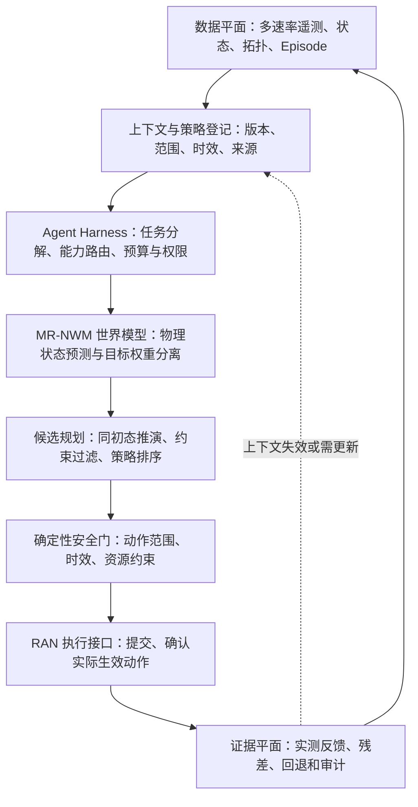
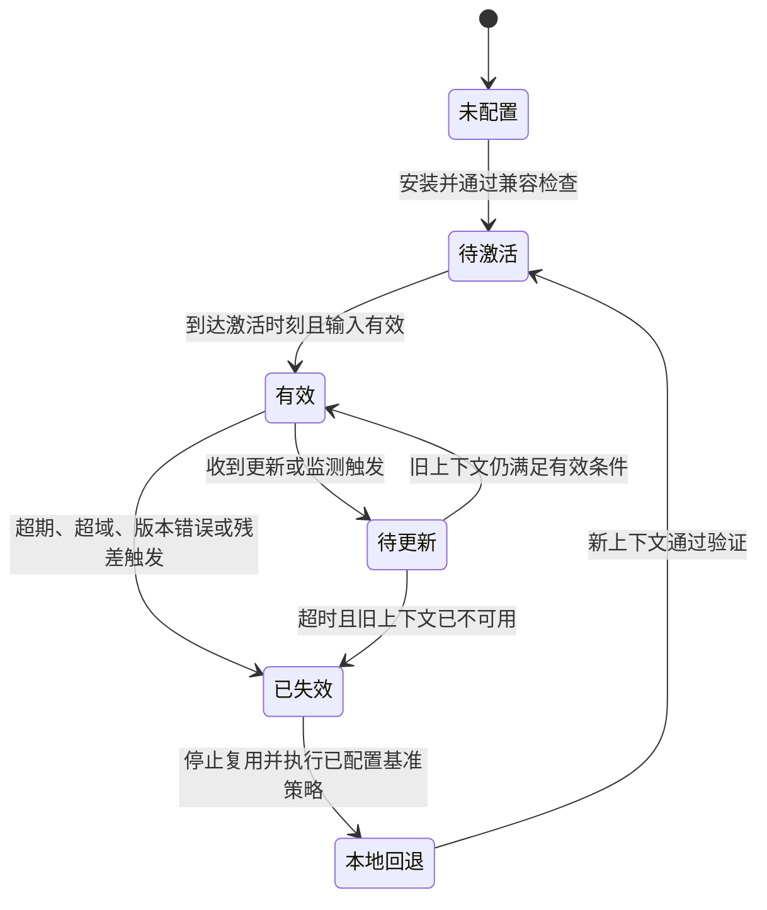

# 面向 6G Agentic RAN 的多时间尺度世界模型与闭环控制技术报告

核对日期：2026-10-29（动作设计与数据边界补充）

文档类型：技术架构与研究路线报告  
范围：本仓库的多速率世界模型（MR-NWM）如何作为 6G Agentic RAN 的预测与决策支撑组件，以及从研究原型走向可验证闭环所需的系统机制。

## 摘要

Agentic RAN 需要把网络目标、异步无线观测、预测、资源动作、执行反馈和安全约束组织成可观测、可恢复的闭环。大型语言模型或智能体适合承担目标理解、任务分解、工具选择与较慢时间尺度的监督；无线动作仍需通过明确的能力接口、可检验的约束和本地执行控制器落地。每个快速控制周期都让通用智能体直接生成射频配置，会扩大时延、可重复性与安全边界的不确定性。

本仓库的 MR-NWM 研究多模态、多时间尺度的无线状态预测，可作为 Agentic RAN 中的世界模型组件。附件提出的核心设计建议也体现在本报告中：将物理状态预测与业务目标评价分开；让慢速上下文处理服务于多个快速候选动作；对不同采样周期的数据保留时间语义；通过明确的上下文适用条件、失效检测和本地回退管理复用。

当前代码已经包含预训练语言模型集成路径、轻量合成基准、多模态时间特征、偏好不变性检查和快层递推等研究组件；尚未实现通用 Agent Harness、实时遥测采集、分布式上下文协议、RIC/E2 接口、真实无线闭环或实网安全保证。因此，本报告将已实现能力、架构建议和待验证假设分别标出，不把设计目标写成已有实验结果或已采纳标准。

规划动作现已单独整理为[《基站规划器动作设计》](PLANNER_ACTIONS_CN.md)，包括六类动作、控制分层、执行记录和验收条件；本报告保留其架构关系与阶段结论。公开数据的动作字段、实际抽检证据及仿真补齐方案见[独立数据文档](PLANNER_ACTIONS_AND_DATA_CN.md)。

## 1. 目标、边界与设计原则

### 1.1 本报告要解决的问题

面向多小区无线资源协调，系统需要同时处理以下因素：

- CSI、链路质量、队列、干扰、拓扑和业务指标更新速率不同，采集和到达时间也可能不同。
- 功率等动作会影响服务小区、邻区和后续队列；同一时刻的多个候选动作需要在可比条件下预测。
- 复杂上下文编码不适合在每个快速控制时刻重复执行，但缓存过期或遇到环境突变时也不能继续盲目复用。
- 吞吐、时延、能耗等业务偏好会变化；偏好变化应调整候选方案的评价方式，不应污染固定动作的物理后果预测。
- 智能体需要有工具权限、动作范围、时限、失败处理和可追溯证据，不能把自然语言计划直接当成网络设备命令。

### 1.2 术语和边界

- **Agentic RAN**：由具备任务理解、规划和工具调用能力的智能体支持无线接入网运维或优化；其动作受网络能力接口、约束检查和执行确认管理。
- **世界模型**：根据当前状态、外生环境和候选动作预测未来状态或反馈的模型。预测结果供候选比较使用，不自动代表真实网络状态。
- **物理上下文**：用于描述预测器版本、适用无线对象、观测、时间范围和动作范围的一组预测条件或适配信息。
- **业务策略**：目标权重、优先级和业务约束。它可以改变候选动作排序；不能被混入未经核实的物理事实。
- **已实现**：在本仓库代码、测试或已提交实验结果中有对应实现或证据。
- **建议设计**：为形成闭环或标准讨论提出的接口与处理方式，尚不表示已经在代码、无线设备或正式规范中实现。

本报告中的“多时间尺度”包含源数据的异步采集、慢速上下文更新、快速状态预测/候选评价，以及更慢的智能体监督。当前模型代码覆盖其中部分模型时钟；不等同于完整的在线调度器。

## 2. Agentic RAN 参考架构

### 2.1 分层职责

| 逻辑层 | 主要职责 | 本仓库关系 | 执行约束 |
|---|---|---|---|
| 目标与编排层 | 解析优化目标，形成带范围和时限的任务；选择工具和能力 | 未来接入 Agent Harness；当前未实现 | 智能体只能调用目录中声明的能力；自然语言需转成经校验的结构化目标 |
| 世界模型与规划层 | 融合带时间信息的观测，预测候选动作的状态变化，向规划器提供比较依据 | MR-NWM 的研究定位 | 候选动作在相同初态、模型版本、观测和时域下评估 |
| 能力与策略执行层 | 生成候选动作，检查约束，调用网络控制接口，确认实际生效值 | 已有参考功率审计、有界多步规划、切片合成执行与反馈记录；没有实网执行器 | 可直接验证的硬约束由确定性逻辑检查；预测约束不等于实测保证 |
| 证据与数据层 | 管理遥测、Episode、时间戳、模型/上下文/策略版本、预测残差和执行结果 | 当前有模拟基准和部分结果记录；在线数据管线待接入 | 区分测量值、模型预测、缺失数据、估算值与合成数据 |

建议将系统职责组织成三个逻辑平面。它们是本项目的设计视图，不是现有标准定义，也不表示代码已有相应分布式部署。

1. **数据平面**：带来源和时间语义的观测、状态估计、业务测量、拓扑、动作记录及 Episode。
2. **控制平面**：Agent Harness、任务分解、能力目录、策略、候选生成、动作约束和网络执行请求。
3. **证据平面**：模型与配置版本、ContextID/PolicyID、预测与实测对齐、残差、时延、拒绝原因、回退记录和可复现评估。

### 2.2 Agent Harness 与无线控制器的分工

Agent Harness 负责运行层面的治理：维护任务状态，选择能力工具，限制每次调用的时间和成本，管理超时与重试，检查输出结构，记录证据，并在依赖失效时把任务交给既有本地控制器。它不应绕过网络执行接口直接写设备配置。

低时延无线闭环由适合其时限的本地组件执行。慢速智能体可以更新目标、请求新上下文、选择可用能力或审阅异常；快速周期使用已安装且仍有效的上下文和经过校验的候选动作。模型推理、任务计划和网络动作各自有超时，且超时行为应确定。

上下文生成实体、快速预测/控制实体和无线执行实体可以同址，也可以分布部署。模型层次不应被固定映射到某一 RIC、CU 或 DU 功能；具体部署位置需根据目标时延、数据可见性、接口能力和失败模式确定。O-RAN 可作为工程实现或测试路径之一，不能由此推断已经完成与特定服务模型的集成。

### 2.3 规划动作与研究阶段

世界模型预测给定动作的后果，规划器在可行域内比较并选择，可选策略网络用于减少搜索成本，三者分别训练或验证。首期保留双链路功率合成任务，新增网络动作优先聚焦切片资源预算与调度模式；波束选择另作为真实配对任务。其余动作族的范围、控制权与依赖统一见[动作设计](PLANNER_ACTIONS_CN.md)，不在本报告展开参数细节。

现已提供动作规格、屏蔽/预算/变化率检查、有界多步规划与现有模型接口；两切片流体队列可生成确认生效的合成转移，具体运行和检查见[实现说明](PLANNER_IMPLEMENTATION_CN.md)。这不是标定无线或包级实验：没有训练切片世界模型，没有新增实网执行或普遍规划收益结论，原论文指标保持原契约。

UC6/UCC 的独立 LSTM 结果仍只支持观测预测，完整语言慢层＋快层没有在这两组数据上训练或评测。公开 DeepSense 波束监督、Colosseum 配置及反馈提供局部数据来源，但 RF 仿真实验平台不等同于商用实网动作干预，恒定配置不能独立识别切换瞬态。后续按“动作数据核验—动力学学习—有限候选规划—独立闭环验收”推进；本次未新增训练或控制收益。

## 3. 多时间尺度数据处理

### 3.1 四种不同的时间

| 时间尺度 | 表示内容 | 更新/使用方式 |
|---|---|---|
| 数据采集时间 | 每个模态自己的采样周期、事件时间、到达时间和缺失状况 | 保留源速率及观测年龄；禁止把异步数据伪装成同时观测 |
| 慢速上下文时间 | 多源物理上下文和业务策略的更新周期 | 形成或刷新物理预测上下文；策略可独立更新 |
| 快速预测时间 | 候选无线动作作用下的状态演进步长 | 对每个候选动作使用隔离的状态副本，复用符合条件的上下文 |
| 智能体监督时间 | 目标变化、跨小区协调、异常处理和模型/策略管理 | 由 Harness 调度，按任务预算运行；不默认进入每个快速控制时隙 |

当前代码明确实现模态的观测年龄、周期和有效掩码，及慢层/快层模型调用路径。参考多窗口 rollout 会推进固定快照观测的年龄并传递预测末态和摘要；它不会自动生成新传感器测量、运行异步调度，或在快层每一步重新检查 TTL。代码中 K 步预测步长与无线毫秒时限之间没有通用换算关系。

### 3.2 观测记录和因果窗口

建议每条观测至少保留：Episode/实体/小区标识、来源、单位、事件时间、到达时间、采样周期、质量或有效位、预处理版本及原始数据引用。决策时刻为 T 时，只有事件时间不晚于 T 且已在该决策可用时间前到达的样本，才可进入因果输入。

对不同模态 m 的观测 j，可计算：

$$
\mathrm{age}_{m,j}=T-t^{\mathrm{event}}_{m,j}.
$$

有效性由事件时间、到达时间、测量质量和应用配置的 TTL 共同决定。TTL 是具体控制任务的配置参数，不能从示例数据中推断为普适无线时限。数据窗口使用尾随聚合；若使用插值、降采样或池化，需要记录算子和窗口边界，并避免未来数据泄漏。

推荐的接入步骤：

1. 统一实体映射和时钟语义，记录事件时间与到达时间；不能建立可靠时间关系的数据流先独立处理。
2. 保留 CSI/IQ、KPI、拓扑、负载等各自原生采样特性，以因果窗口压缩高频数据，给低频数据保留真实年龄。
3. 将值、时间特征、有效掩码、模态类型和必要拓扑关系编码为模型输入；缺失不得静默替换为真实零值。
4. 对跨小区或跨设备训练，只有时间和实体语义匹配的流才可组成同步 Episode；不同数据集不能仅按行拼接。
5. 为超龄、无效或未到达数据定义显式行为：忽略、请求更新、降低控制范围或进入本地回退。

## 4. 物理预测、业务目标与上下文复用

### 4.1 两条逻辑路径

物理预测路径只接收已核实的无线状态、外生条件、实际已生效配置、候选动作、物理上下文及递归状态。业务目标路径将吞吐、时延、能耗等偏好解析成结构化权重和约束。动作候选的物理预测不以目标偏好为输入：

$$
\hat{s}_{t+1:t+H}=F_{\theta,M}(s_t,a_{t:t+H-1},c_t,m_t),
\qquad
w_t=\mathrm{Normalize}(G_{\phi}(i_t)),
$$

$$
a_t^*=\arg\max_{a\in\mathcal{A}_{\mathrm{safe}}}
U(\hat{s}_{t+1:t+H},w_t).
$$

其中 s_t 是决策时的状态估计，a 是候选动作序列，c_t 是外生物理上下文，m_t 是预测器记忆，M 是当前适用的上下文，i_t 是业务目标。若状态、实际物理输入、模型/上下文版本、初始记忆、动作和时域固定，仅改变业务偏好，则对应的物理预测应保持一致；候选排序可以随权重变化。

可执行的数据边界包括：目标文本不进入物理视图；被目标评分污染的隐藏状态和缓存不能回流到物理路径；快层递归记忆和返回物理路径的摘要不包含目标权重、评分或偏好文本。共享神经网络参数不等同于共享运行态。若业务请求确实改变业务到达量或已执行资源配置，应将有证据支持的变化作为物理输入，而不是把意图本身伪装为观测事实。

### 4.2 ContextID 与 PolicyID 分开管理

建议分别标识：

- **ContextID**：物理预测上下文及其模型兼容配置、无线适用域、预测时域、观测新鲜度条件和生命周期。
- **PolicyID**：业务目标版本、目标权重、业务范围及可检验约束。

在物理输入、动作覆盖范围和上下文仍满足有效条件时，业务目标切换可以只更新策略，不必重新传送物理上下文。若缓存了完整候选预测轨迹，则重新使用该轨迹还需匹配动作、初态、时域和上下文版本；新候选动作即使处在适用范围，也要重新推演。上下文缓存复用不是无条件的预测结果复用。

上下文建议在以下任一条件发生时失效或待更新：版本不兼容、序号过旧、超出有效时间、必要观测超龄、状态或动作超出适用域、关键无线配置未经上下文覆盖地变化、已执行动作的预测残差持续越界。阈值、连续次数、迟滞和恢复条件应按任务验证配置，不在报告中臆造固定数值。

## 5. 多小区下行功率协调：Agentic RAN 闭环示例

此处选择多小区功率与干扰协调作为主示例，因为它与仓库的双链路合成参考任务最接近。该示例是建议的无线闭环设计，不能把合成基准结果解释为真实网络效果。

1. **接收目标。** 上层智能体将“提高吞吐”“降低能耗”等请求转换为允许的结构化目标、范围和期限；未通过解析与校验的字段不执行。
2. **整理证据。** 数据管线获取服务/邻区链路、干扰、队列、拓扑以及实际功率配置，附时间戳、来源、质量和数据有效期。
3. **更新物理上下文。** 慢层根据当前物理证据生成或刷新预测上下文；偏好单独形成策略版本。接收端在使用前检查模型配置、作用对象、时域、序号和观测条件。
4. **建立候选动作集。** 规划器生成受支持的功率组合；对每个候选建立独立的状态和快层递归记忆，从同一测量初态预测未来状态。禁止把候选 A 的预测末态作为候选 B 的初态。
5. **执行硬约束过滤。** 对设备能力、明确配置的功率范围和可直接核验的资源约束运行确定性检查。预测输出不能替代硬约束验证。
6. **按策略排序。** 仅在已通过硬约束检查的候选集合中，按物理预测和策略权重排序。这里的“最优”只指当前候选集和目标函数下的排序结果，不表示全局最优或业务保证。
7. **提交并确认动作。** 通过受控接口提交选择结果，记录请求动作、实际生效值、生效时刻及失败原因；不得把未确认的请求值当成已执行事实。
8. **反馈与失效处理。** 将时间对齐的实际状态与相应预测比较，生成预测残差。过期、超域、版本不兼容、超时或残差触发后，暂停复用、请求更新，并在需要时切换到本地基准控制器。
9. **形成可复现 Episode。** 保存观测快照、候选集、模型/策略/上下文版本、约束结果、执行确认、后续测量与失效原因，使离线评估能复算动作选择。

## 6. 上下文生命周期和失败行为

### 6.1 建议的上下文信息

以下是用于研究与互通分析的功能性字段建议，不是现有标准消息或已提交的信息元素。

| 信息类别 | 建议语义 | 目的 |
|---|---|---|
| 身份与顺序 | ContextID、单调序号、生成时间、来源实体 | 关联更新与反馈，拒绝乱序旧上下文 |
| 模型兼容 | 模型/适配器版本、输入输出语义、单位、归一化版本 | 阻止不兼容模型或坐标系错误复用 |
| 作用范围 | 小区/载波/资源集合、状态和动作范围 | 明确适用的无线对象和动作域 |
| 时间语义 | 参考时钟、激活时间、有效期、预测步长和时域 | 确定跨实体使用时间和过期行为 |
| 输入条件 | 必要观测、最大年龄、缺失/质量条件 | 判断当前证据是否满足推理前提 |
| 策略对象 | PolicyID、业务范围、目标权重和约束版本 | 支持策略独立更新 |
| 反馈关系 | 实际动作、生效时间、对应 ContextID/PolicyID、实测状态和残差 | 支持误差检测、审计和更新触发 |
| 载荷 | 模型无关的上下文摘要或已协商兼容的实现载荷 | 避免默认交换不兼容的内部张量 |

仅传送模型标识并不足以确保跨厂商互通。若实现间传送 FiLM、低秩矩阵等内部张量，必须另行定义维度、精度、归一化和计算语义；否则应将其作为厂商内部实现，不假设网络节点可解释。跨厂商规范更适合先规定外部可观察的输入、适用范围、预测/反馈语义和生命周期行为。

### 6.2 状态机与确定性回退

收到更新请求本身不要求立即停用仍然有效的上下文；一旦失效就必须停止复用。模型语义或动作定义变化时，应显式决定递归记忆重置或状态转换。回退策略只能声称自己确实执行的明确约束，不应宣称任意故障下的零中断或无线可靠性保证。

## 7. Agentic RAN 的安全与运行治理

- **能力目录**：每个工具声明输入/输出结构、授权对象、动作上限、时限、幂等性、错误码和证据要求。
- **分级权限**：观测/仿真、生成候选、提交配置、确认执行分开授权；高影响动作经过本地约束门。
- **有限动作面**：智能体调用有界动作集合，不拼接自由文本命令；所有写入都携带作用对象、有效时间和关联标识。
- **独立安全门**：模型分数不能覆盖设备能力、已配置功率上限等可验证约束。
- **时限与停止行为**：预测超时、工具断连、上下文过期或策略解析失败时，使用定义好的本地控制路径，不阻塞快环等待智能体。
- **证据链**：保存调用输入摘要、模型/策略/上下文版本、候选和拒绝原因、执行确认与实测反馈；敏感网络标识按部署要求最小化和保护。
- **负向测试**：覆盖乱序上下文、重复提交、过期数据、模型版本不匹配、部分测量丢失、执行失败、快环超时和目标骤变。
- **角色隔离**：研究/仿真工具默认没有生产控制权限；只有经过环境配置、授权和安全验证的执行器才可连接真实网络。

## 8. 评估方案与证据要求

模型误差、无线控制收益和系统运行成本须分别报告。单步预测精度或主机端模型耗时都不能单独证明 Agentic RAN 端到端有效。

| 评估维度 | 建议指标 |
|---|---|
| 状态预测 | 按状态特征和预测步长报告误差、校准和突变恢复；明确训练/测试划分及分布外场景 |
| 动作价值 | 在同等状态、候选、硬约束和预算下比较吞吐、队列/时延、能耗、干扰及长期累计效果 |
| 约束与安全 | 硬约束违反次数/比例、无效动作拒绝率、超域动作识别和回退正确性 |
| 上下文治理 | 更新次数、复用命中条件、上下文年龄、失效检测延迟、过期上下文动作比例 |
| 系统成本 | 数据采集、排队、传输、推理、验证和执行总时延的分位数；上下文字节数、智能体调用次数和资源占用 |
| 鲁棒性 | 丢包、乱序、时钟偏差、目标切换、外生突变、执行拒绝和模型接口故障下的闭环表现 |
| 可审计性 | 固定 Episode、模型版本和策略后能否复算候选预测、约束判定、动作选择与回退原因 |

至少与以下基线比较：既有本地控制/规则策略、独立轻量状态预测器、模块化预测器加目标解析、固定周期上下文刷新、事件触发刷新、合适的 MPC/优化器，以及不使用缓存上下文的版本。保持可见观测、动作集合、硬约束、计算预算和数据划分可比。

建议做两组关键隔离试验：

1. 固定物理输入、初态、动作、上下文和预测时域，仅切换业务偏好，检查物理预测保持一致而候选排序可变化。
2. 注入测量过期、突发干扰、动作超域、旧序号、模型不匹配和执行失败，检查停止复用、更新请求、回退及恢复行为。

当前已提交的论文数值来自合成参考任务。该基准可验证实现路径和受控实验流程，不能推导真实无线网络的控制增益、端到端时延或部署可靠性。新增实验应附原始结果、配置、随机种子、代码版本和数据来源；缺失值必须标记缺失，合成、实测和估算结果分开展示。

## 9. 面向标准化的技术边界

标准化价值应来自跨实体协同所需的可观察行为，不来自“使用智能体”“采用大模型”或“部署在 6G 基站”等标签。本报告建议先形成问题陈述、用例、接口开销和失效测试，再对照具体版本的正式规范、工作项、标准提案与现有专利进行逐项检索。这里的机制、字段和状态机均属研究建议，没有声称已被 3GPP、O-RAN 或其他组织采纳。

优先分析的互通问题：

1. 接收实体如何识别上下文所对应的模型语义、无线对象、动作域和预测时域？
2. 不同采样率的数据如何表达事件时间、到达时间、年龄、缺失和有效期？
3. 策略变化何时可独立于物理上下文更新；什么条件会使缓存失效？
4. 实际动作与后续测量如何关联到预测版本，以便检测残差和跨节点不一致？
5. 超时、乱序、模型不兼容或预测失效时，各实体执行什么确定性行为？
6. 相比现有预测/数据采集机制，新增交互带来的字节数、更新次数和处理时延是否值得？

协议设计应尽量描述模型无关的外部语义，避免要求网络统一内部神经网络、模型权重或隐藏张量。3GPP 与 O-RAN 的功能、接口和规范体系应分别核对；O-RAN 工程集成不能替代 3GPP 标准依据。具体工作组、规范版本、职责和时间计划在提交前必须根据届时正式资料确认。

## 10. 当前仓库能力与缺口

| 范畴 | 当前仓库已有证据 | 仍待完成 |
|---|---|---|
| 世界模型 | 预训练语言模型集成路径；轻量随机初始化参考路径；快层递归预测 | 真实无线数据上的任务训练与独立验证 |
| 多模态时间信息 | 数值模态适配、观测年龄/周期/有效掩码、可选拓扑消息传递 | 设备采集、射频校准、在线时间对齐、流式更新与时钟偏差管理 |
| 目标与预测隔离 | 双视图、目标输出头、固定动作下的偏好不变性测试 | 完整智能体目标解析、策略版本管理、在线漂移和对抗输入测试 |
| 候选动作评估 | 合成双链路功率参考任务、有限候选集过滤/评分 | 多小区闭环执行、独立候选状态管理、真实物理约束和外部控制接口 |
| 上下文管理 | 模型内部慢层/快层缓存与跨窗摘要 | 分布式 ContextID 生命周期、乱序拒绝、TTL/残差失效状态机、恢复 |
| Agentic RAN | 文档可定义架构目标 | Agent Harness、能力目录、权限/预算系统、工具超时、执行审计与安全门 |
| 工程集成 | Python 模型 API 和实验脚本 | RIC/E2 或其他受支持的网络接口、目标硬件端到端计时和实网测试 |

代码事实入口：[模型架构与多时间尺度数据处理](ARCHITECTURE_CN.md)、[部署边界](DEPLOYMENT.md)、[公开真实数据集调研](REAL_DATASETS_CN.md)、[结果摘要](../results/SUMMARY.md)、[预训练模型接口](LANGUAGE_FOUNDATION.md)。当前结果摘要中标注的基准来自合成任务；读取或运行该仓库时，应以对应文件和实验配置为准。

## 11. 建议实施顺序

### 阶段 A：可复现模拟闭环

- 建立具备可控采样率、时钟偏差、缺失、突发干扰和多小区耦合的无线仿真 Episode。
- 让每个候选动作从相同实测初态和独立记忆开始；记录整段预测和硬约束判定。
- 实现独立的 ContextID/PolicyID、适用域、有效期、序号和残差触发状态机。
- 加入本地确定性基线和安全动作门，验证失败时不会等待智能体或复用过期上下文。

### 阶段 B：实测轨迹和模型训练

- 逐个数据源核对许可、采样语义、设备字段、时间戳和与动作的可关联性。
- 先用离线真实测量评估状态预测与动作效果模型；无法与执行动作/后果对齐的数据不用于声称闭环控制价值。
- 对比轻量模型、模块化模型和预训练骨干，在同等数据与预算下报告消融。
- 评估分布偏移、校准、数据泄漏、长时域误差和超域拒绝。

### 阶段 C：受控测试床

- 先在隔离仿真或实验网验证观测、候选生成、配置确认和反馈关联。
- 采用只读、建议模式和有限动作权限逐步扩展；每一级设定人工/本地控制回退。
- 在目标硬件测量采集到执行的完整延迟分布、负载尾部、更新流量和恢复时间。
- 只有安全门、日志和回退经过独立验证后，才讨论生产网络试点。

## 12. 主要研究假设与未决问题

本项目值得检验的系统假设，是物理/目标隔离、带时间语义的多速率上下文、快层候选预测、上下文有效性治理和确定性回退之间的组合，能在控制质量可比的条件下降低重复上下文处理，同时避免使用过期预测。该假设需要端到端对照实验；当前材料不能证明它在真实无线场景已经成立。

优先未决问题：

- 慢层上下文应该携带可移植语义，还是只在同一模型配置内缓存实现参数？
- 哪些无线状态和动作足以覆盖主实施例；如何检测状态或动作超出训练/验证适用域？
- 残差由谁计算、需要何种时间对齐、使用怎样的迟滞与更新成本？
- 业务目标如何从自然语言可靠地转为约束，同时区分软偏好和不可违反条件？
- 多候选 rollout、相邻小区协调和负载突变下，时延与计算预算如何缩放？
- 对已有数据采集、预测信息和模型生命周期机制，实际缺少的互通语义是什么？
- 哪些贡献有代码与实验支撑，哪些属于后续协议设计；专利可专利性与标准必要性仍需独立检索和法律评估？

## 参考文件

- [项目 README](../README.md)
- [模型架构与多时间尺度数据处理](ARCHITECTURE_CN.md)
- [模型部署边界](DEPLOYMENT.md)
- [公开免费真实数据集调研](REAL_DATASETS_CN.md)
- [基站规划器动作设计](PLANNER_ACTIONS_CN.md)
- [公开动作数据核查与训练方案](PLANNER_ACTIONS_AND_DATA_CN.md)
- [基站世界模型进展报告](PROGRESS_REPORT_CN_2026-10-23.md)
- [实验结果摘要](../results/SUMMARY.md)
- [论文主文](../paper/main.tex)
- 源码：src/mr_nwm/foundation.py、model.py、modalities.py、experts.py；测试：tests/test_foundation.py
- 技术撰写建议依据：用户提供的《面向6G标准化的无线通信专利撰写修改意见_20261021.md》
