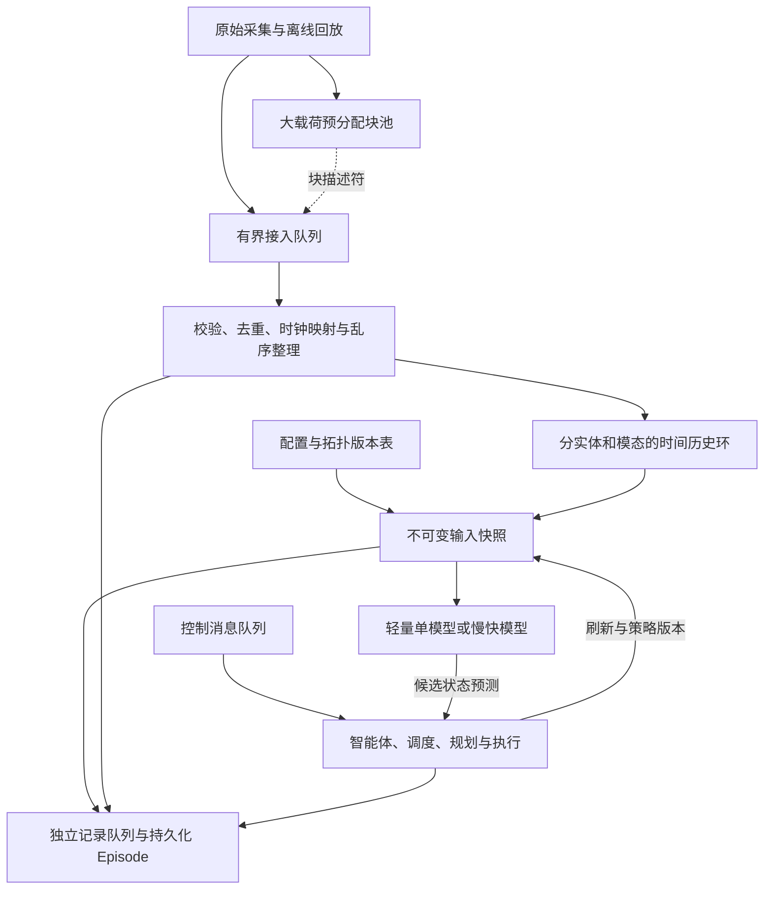
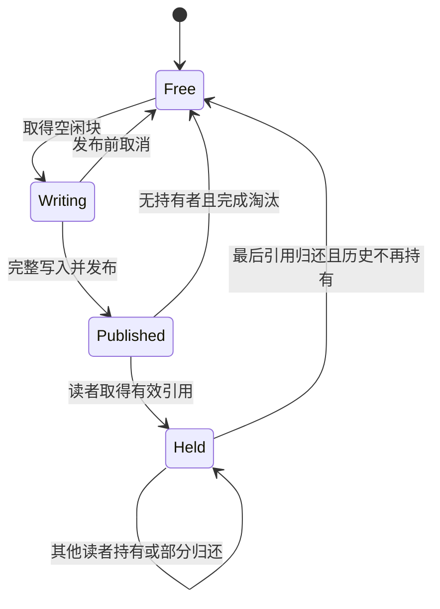

# MR-NWM 多时间尺度数据结构设计与问答

**项目：** [xuda1979/6G-MR-NWM](https://github.com/xuda1979/6G-MR-NWM)  
**更新日期：** 2026年10月28日  
**状态：** 面向实现和评审的设计方案；现有能力与待开发能力见第 2 章。  
**代码核对基线：** [79ae31f31570ffd029023d87ab6b04a28bf731c7](https://github.com/xuda1979/6G-MR-NWM/tree/79ae31f31570ffd029023d87ab6b04a28bf731c7)。

本项目需要把不同频率、不同体积、不同到达时间的无线与环境观测，组织成模型能够稳定读取、训练能够回放的输入。合适的结构是：**采集入口用有界队列，近期数值历史用带时间索引的环，推理使用不可变快照，大载荷按需用内存池，控制事件用消息队列，长期数据写入 Episode。** SPSC、双缓冲和共享内存各解决其中一部分问题，不能单独覆盖完整链路。

本设计同时支持轻量单模型和“上层智能体—中层慢模型—下层快模型”。采用这些数据结构不要求先训练语言模型，也不使现有秒级 KPI 自动具备毫秒级控制标签。文中的频率、TTL、容量及无线数值凡标为示例，均用于说明设计，不能视为实测性能。

## 阅读导航

| 需要回答的问题 | 阅读位置 |
|---|---|
| 为什么不能只用一个环形 FIFO | 第 1、3、5 章 |
| 当前代码到底具备哪些能力 | 第 2、9 章 |
| 每条数据保存什么，时间怎么算 | 第 4、6 章 |
| SPSC、双缓冲、消息队列、Stream Buffer、内存池如何选 | 第 3、5、7 章 |
| 快慢模型怎么读、何时更新 | 第 8、9 章 |
| 内存怎么算，满了怎么办，能否零拷贝 | 第 7、10、11 章 |
| UC6/UCC 怎么接，缺什么训练数据 | 第 12 章 |
| 怎么实现和验收 | 第 13、14 章 |
| 评审中的常见问题 | 第 15 章 |
| 依据和术语 | 第 16 章 |

## 1. 项目需求与核心设计决定

### 1.1 多时间尺度包含不同的时间概念

| 时间概念 | 本项目含义 | 例子与边界 |
|---|---|---|
| 采集/统计周期 | 数据源多久产生一条记录，或一条统计覆盖多长区间 | CSI 特征可较快，KPI 较慢；区间长度与上报周期不一定相同 |
| 传输与处理时延 | 测量发生后，多久到达接入层、完成特征处理 | 到达较晚的旧记录，不因为刚收到就变成新测量 |
| 历史窗口 | 本次模型要看多长的过去 | 短 CSI 历史与较长 KPI 历史可共同进入快照 |
| 数据有效期 | 某任务允许观测有多旧 | 最新观测门限与历史 token 允许年龄应分别设定 |
| 慢层刷新周期 | 物理上下文/调制包多久重新生成 | 可按宏窗口刷新，也可由异常触发；外部调度待实现 |
| 快层预测步长 | 预测轨迹上两个状态之间的物理间隔 | 当前代码按步递推，调用方必须定义对应物理时间 |
| 真实决策调用周期 | 系统多久用新测量重新决策 | 不等于一次 forward 内循环计算 K 步的耗时或定时触发 |

环形缓存解决有限内存下的持续写入和近期读取。时间戳、窗口选择、时钟映射、有效性和调度共同决定这些数据能否用于同一次预测。

### 1.2 必须满足的行为

1. 同一小区、终端、模态和轨迹的数据可以关联；不同来源的无关记录不会被误拼。
2. 同一记录允许被多个重叠窗口、候选方案和模型反复读取。
3. 一次预测读到的值、版本和策略保持固定，后台继续采集。
4. 所有队列、历史区、整理区、块池和待处理请求都有容量上限。
5. 丢失、覆盖、迟到、过期和拒收能够定位到流、时间区间和原因。
6. 训练/回放能够重建当时可见输入，不混入未来信息或未执行动作。
7. 数据工程不依赖慢模型是否启用；增删模型不会改变原始观测语义。

### 1.3 结构分工



图中块池是载荷存储，队列传输记录或引用，历史环保留近期内容，快照固定一次推理的输入，持久化层负责长期记录。它们是可以组合的不同职责。

## 2. 当前项目实现与设计边界

| 对象或能力 | 仓库现状 | 本设计需要补齐的工作 |
|---|---|---|
| `ModalityObservation` | 有 `values / age_seconds / period_seconds / valid / adjacency / max_age_seconds` | 采集端身份、事件/到达/就绪时间、时钟映射、字段质量、来源与版本 |
| `TypedModalityEncoder` | 数值投影、模态/时间嵌入、token 有效和过期掩码，可选图消息传递 | RF 校准、视觉/点云编码、因果历史选取、字段级缺失适配 |
| `FoundationInputs` | 目标文本 token、模态字典、可选已核实外生事实；`advance` 只增加年龄 | 从快照构造输入；持久化快照和时钟/来源映射 |
| 慢层与快层 API | `forward_slow_tier`、`forward_fast_tier_step`、单次 K 步 forward | 在线刷新协调、上下文版本与适用条件、调度和执行集成 |
| 跨窗口预测 | 传递末态和 `sync_summary`；语言路径可推进固定观测的年龄 | 逐窗口装入新测量、实测状态修正、事件触发更新 |
| `UC6Windows / UCC5GWindows` | 离线历史/未来张量、移动上下文、字段掩码、会话/片段、划分与归一化统计 | 实际物理时间跨度审计和严格因果预处理版本 |
| UC6/UCC LSTM | 已有独立观测预测实验；不使用完整慢快架构 | 掩码/年龄输入、强基线、统一环境及按物理时域评测 |
| 在线队列、历史环、块池、快照服务、Agent Harness | 尚无完整实现 | 按第 13 章逐步开发，不能把本文类名或伪代码当成已提供的 SDK |

代码入口：[modalities.py](../src/mr_nwm/modalities.py)、[foundation.py](../src/mr_nwm/foundation.py)、[model.py](../src/mr_nwm/model.py)、[uc6.py](../src/mr_nwm/uc6.py)、[ucc5g.py](../src/mr_nwm/ucc5g.py)。

现有模型接口的一处重要限制是：`valid` 为 `[B,N]` 的 **token 级掩码**，不是 `[B,N,d]` 的字段级掩码；`period_seconds` 是每个模态对象的标量。来源中部分字段缺失、采样间隔变化等情况，不能假定当前适配器已经全部支持，详见 9.1。

## 3. 各类结构的适用性与选择理由

| 结构 | 适用位置 | 对本项目的价值 | 不承担什么与选择条件 |
|---|---|---|---|
| SPSC 环形 FIFO | 一路采集器到一个整理线程 | 固定内存、简化交接和并发证明；高速数值块可批量传输 | 不直接承担多个模型的共享历史；只有单写单读才成立 |
| 带时间索引的历史环 | CSI/KPI/视觉特征近期窗口 | 保留有限历史并按时间反复读取，支持快慢窗口 | 不代替乱序排序、长期数据库或完整并发协议 |
| 双/三缓冲 | 只要最新整帧的一次采集到一次编码交接 | 减少帧复制，完整发布 | 需归还协议；两/三块不能保证任意慢读者下永不缺块，也不保留多帧历史 |
| 有界消息队列 | 控制、刷新、告警、执行确认 | 消息边界、处理状态、ID/版本/截止时间易管理 | 消息优先级需显式实现；任务唤醒优先级不等于消息排序优先级 |
| 字节 Stream Buffer | 串口/RTOS/驱动字节入口 | 连续字节或 ISR 到任务的交接 | 需解析帧边界、校验和时间；不是模型历史结构 |
| Message Buffer | 保留变长消息边界的端侧交接 | 比裸字节流更清楚地传递离散记录 | FreeRTOS 原生 Message Buffer 与 Stream Buffer 主要面向单写单读；不同于固定大小 Queue [S3] |
| 预分配内存池 | 图像、IQ、点云块及稳定尺寸的张量块 | 限制总内存，减少热路径分配；引用可被多个读者共享 | 本身不排序、不排队、不保证零拷贝；需完整生命周期 |
| 版本表 | 配置、拓扑、策略 | 按生效区间还原历史版本 | 不仅保存最新值；不能用当前配置解释旧测量 |
| 持久化日志/文件与索引 | Episode、原始数据、训练和审计 | 独立于在线缓存保留长期内容并支持检索 | I/O 积压仍需有界队列和显式保存策略 |

**当前优先级：**先做好小型数值历史环、复制快照和回放；随后按实际 CSI/IQ 的吞吐需求评估原生 SPSC；确定大帧任务需要最新帧还是帧序列后，再选择双/三缓冲或块池。UC6/UCC 当前以离线 KPI 为主，不需要为了“实时架构完整”而先接入 RTOS 或共享内存中间件。

`kfifo` 是 Linux 的一个内核 FIFO 实现；Linux 还存在其他环形机制。“环形缓冲”的一般概念不要求调用内核 `kfifo`。满时覆盖、返回失败、丢新、有限等待等是接口策略，不能从结构名称直接推导。[S1][S2]

## 4. 数据对象与字段契约

### 4.1 四层对象

| 对象 | 保存什么 | 主要索引 | 谁负责 |
|---|---|---|---|
| `StreamSpec` | 模态、字段顺序、单位/维度、周期语义、时钟、任务有效性与容量策略 | `stream_id + schema_version` | 数据接入与配置管理 |
| `ObservationRecord` | 一次测量或一段统计的值/载荷描述符、时间、质量和来源 | `episode_id + entity_id + stream_id + sample_id` | 采集、整理与历史服务 |
| `ObservationSnapshot` | 某次 T/A 下选中的记录、私有张量或有效持有引用、边界和版本 | `snapshot_id` | 快照协调器 |
| `EpisodeManifest` | 会话/轨迹、原始块与快照引用、模型/策略版本、预测/动作/反馈和划分 | `episode_id` | 持久化与训练管线 |

这些是拟开发的应用对象，只有第 2 章列出的模型类型已存在。流的长字符串和静态元数据可在 `StreamSpec` 中登记，热路径用短 ID 和固定宽度字段。

### 4.2 一条观测的必要字段

| 字段组 | 字段 | 约定与用途 |
|---|---|---|
| 身份 | `episode_id, entity_id, cell_id, stream_id, modality` | 数据按轨迹/实体隔离；小区切换记录关联变化，不只靠数组位置推断 |
| 唯一性 | `sample_id, source_id, source_sequence` | 去重并检测源端缺号；同时间戳不等于同一条数据 |
| 接入顺序 | `ingest_sequence, cache_sequence` | 分别记录接收顺序和整理后的提交顺序；不能与源序号混用 |
| 测量时间 | `event_time_ns` | 校正到参考时钟的测量时间；保留原始源时间及映射版本 |
| 到达/就绪 | `arrival_time_ns, ready_time_ns` | 原始内容到接入端、派生特征真正可用的时间；就绪时间不能伪造为测量时间 |
| 统计区间 | `interval_start_ns, interval_end_ns` | 区间统计以结束时刻作事件时间，且整个区间必须满足因果条件 |
| 时钟 | `clock_id, clock_mapping_version, time_uncertainty_ns` | 说明对齐依据和误差；未映射的不同设备时钟不可直接相减 |
| 载荷 | `values` 或 `payload_ref` | 小数值内联，大块按描述符引用；保存 shape、dtype、布局和设备位置 |
| 字段质量 | `field_valid, quality_flags` | 缺失、异常、插补、降采样、实测/仿真/派生等分开标记 |
| 版本 | `schema_version, feature_version, normalization_version` | 字段/特征/归一化兼容性可检查；归一化统计仅从训练组拟合 |
| 来源 | `dataset_id, source_file, raw_ref, raw_hash` | 特征能追到原始块；哈希可按块计算，不要求逐样本重复计算整文件 |

`period_ns`、`ttl_ns`、峰值率和容量策略通常登记在流/任务配置中。记录确有不同区间长度时仍逐条保存，不能用一个名义周期替代实际时间。

`ready_time_ns` 适用于异步视觉/射频特征：原帧 9.995 s 到达，但编码到 10.003 s 才完成，10.000 s 的在线决策不能把现成特征当作当时已就绪。另一种允许的实现是冻结当时已到达的原帧，再在本次决策预算内编码；要另记处理完成时间，并遵守执行截止，不能宣称编码不耗时。

### 4.3 完整的小型 KPI 示例

下例时间相对同一 Episode 起点；数值为虚构的接口示例。标量/数组字段仅展示序列化形式，不规定 Python 对象布局。

```json
{
  "episode_id": "demo-001",
  "entity_id": "ue-07",
  "cell_id": "cell-A",
  "stream_id": "ue07-kpi",
  "modality": "kpi",
  "sample_id": "kpi-99",
  "source_id": "receiver-1",
  "source_sequence": 99,
  "ingest_sequence": 106,
  "cache_sequence": 101,
  "event_time_ns": 9900000000,
  "arrival_time_ns": 9920000000,
  "ready_time_ns": 9921000000,
  "interval_start_ns": 9800000000,
  "interval_end_ns": 9900000000,
  "clock_id": "episode-reference",
  "clock_mapping_version": "identity-v1",
  "time_uncertainty_ns": 0,
  "period_ns": 100000000,
  "values": [82.0, 18.0, -10.5, -88.0],
  "field_valid": [true, true, true, true],
  "quality_flags": ["synthetic-example"],
  "schema_version": "kpi-mbps-ms-dB-dBm-v1",
  "feature_version": "demo-v1",
  "normalization_version": "training-stats-v1",
  "raw_ref": "episode/demo-001/kpi/block-0001"
}
```

零时间不确定性只用于上述同钟构造示例。真实采集要保存可追溯的对时误差，不能默认误差为零。

### 4.4 大块描述符与持久化引用

一个本机共享块的描述符可包含：

```json
{
  "pool_id": "camera-ue07-rgb-v1",
  "block_id": 12,
  "generation": 41,
  "byte_offset": 0,
  "byte_length": 921600,
  "shape": [480, 640, 3],
  "dtype": "uint8",
  "layout": "HWC",
  "device": "cpu-shared-memory"
}
```

该描述符只在块池运行实例和有效持有期内可解释。持久化时需写实际载荷或稳定文件/对象引用及哈希；进程重启后不能用旧 `block_id` 假装原数据仍在。跨进程用可映射的句柄/偏移，不传本进程裸指针。

### 4.5 快照、上下文、策略和动作记录

| 对象 | 必须关联的内容 | 更新规则 |
|---|---|---|
| 快照 | T、到达/就绪截止 A、每流读取边界、选中 sample ID、年龄/质量、时钟/特征/归一化/配置版本、缺失与完整性 | 一次决策构造后不改；在线新数据只进入新快照 |
| 上下文包 | `gamma, beta, lora_a, lora_b, context`，快照和模型版本、实体、生成时间与适用条件 | 慢层完整生成后发布；已用旧版本的推理持有至完成 |
| 策略配置 | 人设目标权重、硬约束、任务/动作范围、PolicyID 和生效点 | 单独版本管理，不由慢层无约束改变 |
| 预测记录 | SnapshotID、ContextID、模型/策略版本、候选动作、预测步长/起点、状态轨迹、候选独立记忆标识 | 不当成实测数据写回观测历史 |
| 动作反馈 | 请求 ID、请求值、实际生效值、生效时间、成功/拒绝/超时、后续独立测量 | 以执行确认关联；请求不等于实际动作 |

## 5. 两种环的具体实现与并发规则

### 5.1 接入 SPSC 的角色

一条接入 SPSC 中，一个生产者写一个位置，一个消费者读一个位置；槽位在归还后才可重用。传输的数据可以是固定数值记录，也可以是指向已发布只读载荷的描述符。用连续索引不需要把剩余数据整体前移；跨数组末尾的数据可能分成两段。

在 C/C++ 用户态实现中，使用标准原子及目标平台支持的顺序保证：先完成载荷，再 release 发布写边界；消费者 acquire 观察后读载荷；读完 release 发布回收边界，生产者确认回收后才能重写。该说明是所有权约束，不是可直接复制的完整无锁代码。`volatile` 不等于线程同步；Python GIL 也不构成跨进程或所有原生操作的完整协议。[S1]

如果同一个设备有两个接收回调同时写同一队列，就已经不是单生产者。可由一个接收线程归并后写、每路各用 SPSC，或改用正确的 MPSC/锁队列；不能只把变量命名为 SPSC 就认为条件成立。

### 5.2 SPSC 满时不能任意抢读者的槽

推荐初版 `try_push` 失败时拒收新记录并增加丢失计数，或由消费者有控制地跳过积压。需有限等待时也必须明确超时和上游是否允许阻塞。若要求覆盖式传输，应采用经过验证的覆盖协议，不能由生产者擅自改 `tail`，因为读者可能正在复制该槽。

Linux 文档中的 `kfifo_put` 满时返回 0，`kfifo_in` 返回实际写入量，不能假设自动覆盖或阻塞。变长字节写入还要检查是否只写入部分内容，避免把半个应用消息当作完整观测发布。[S2]

### 5.3 模型历史环的布局与索引

建议每个 `(episode_id, entity_id, modality, stream_id)` 分区保存：

| 数组或索引 | 形状/内容 | 用途 |
|---|---|---|
| 数值列 | `values[C,d]` | 固定模态维度，便于批量转张量 |
| 时间列 | `event/arrival/ready[C]` | 因果、有效性和时间范围选择 |
| 质量列 | `field_valid[C,d]` 与质量编码 | 缺失和派生状态不丢失 |
| 序号列 | 完整 `cache_sequence[C]`、源/接入序号 | 识别绕回、覆盖、重复和来源 |
| 载荷引用列 | 块描述符/原始引用 | 大数据不内联反复复制 |
| 分区状态 | 写边界、最早保留边界、水位线、丢失/迟到计数 | 约束读取范围和完整性 |

设第 q 次提交的槽为 `q % C`，完整序号用于区别第一次和后续绕回。2 的幂容量可简化某些实现的取模，但不是结构的普遍要求。留一个空槽辨别满/空的实现，其可用容量比物理槽数少 1，预算要分清。

经乱序整理后，逻辑记录按事件时间有序；物理环绕回可形成两段有序区间，按时间索引检索并复制到私有输入。多条记录时间相同时用稳定次序保留。复杂任意时间插入不在主环内搬移完成，交给第 6 章的整理/迟到路径。

**历史读取不推进全局消费指针。** 10.000 s 取过的数据，10.020 s 仍可再取。历史淘汰由写者按窗口和容量策略管理，而不是“某个模型读完就删”。

### 5.4 初版并发选择

每分区一个写者，提交和快照复制使用短锁；重计算、模型推理、文件 I/O 和设备等待都放在锁外。快照协调器串行构造一次输入，记录各流实际边界，并对复制量设上限。此方案优先保证输入一致性，不宣称已满足硬实时。

如果锁时间成为瓶颈，可在测量后采用不可变块、引用固定、双版本元数据等优化。仅检查序号前后相等不足以自动证明任意载荷读写安全；特别在 C/C++ 中，未同步的同一内存并发读写不能靠事后发现变化来消除数据竞争。

### 5.5 快慢模型与日志器的多读者策略

| 方案 | 读取/回收方式 | 适合阶段与代价 |
|---|---|---|
| 私有复制快照＋独立记录队列 | 统一模块复制历史；各模型用自己的固定输入 | 初版优先；复制内存和短锁时间需测量 |
| 多读者环形日志 | 各读者保留独立序号；可回收边界受保留策略影响 | 共享历史确有价值时；最慢读者、超时和覆盖须定义 |
| 块池＋每读者描述符队列 | 载荷共享、队列独立、引用归还后回收 | 大帧/多进程；池耗尽与故障恢复复杂 |
| 从持久化读取 | 不占在线历史，只读已保存数据 | 训练、长历史分析、审计；承受 I/O 延迟 |

若允许覆盖落后读者，读者必须检测缺口并重同步；若要求不丢所有读者的未读数据，则需要背压或停止条件。独立 offset 只描述读到哪里，不单独保证内存寿命或无限历史。

## 6. 时间、乱序、窗口和缺失处理

### 6.1 时钟与物理时间

事件/到达/就绪时间统一到可比较的参考时间轴，存为整数纳秒等固定单位。保留源时钟和映射版本；本机耗时用单调时钟测量，避免墙上时钟跳变。不能拿未校准的设备时钟与接收服务器时间直接计算负载时延。

对统计记录，事件时间取统计区间结束；对摘要特征，保留区间起止与特征生成时刻。若对时误差已经大于任务容忍的 5 ms 等示例门限，不能宣称严格满足该门限；应标记时间不确定性，按任务策略隔离、扩大安全余量或拒用。

### 6.2 因果可见性

设预测参考时刻为 T，到达/就绪截止为 A。使用已预先计算好的特征时至少满足：

$$
t_e\le T,\qquad t_a\le A,\qquad t_r\le A,\qquad
\mathrm{age}=T-t_e\ge0.
$$

另外检查实体、质量、版本、统计区间和任务年龄条件。T 表示预测从哪个物理时刻出发，A 表示当次允许看到哪些数据。可以在晚于 T 时构造以 T 为起点的延迟预测，但必须公开 A 和实际输出/执行时刻，不能与 T 当场决策混报。

初版演示可设 A=T；模型计算当然仍需时间。执行前需另检查实际动作截止与最新状态。已经冻结的快照不会因为晚到一条旧数据而被改写，离线修正应生成新版本。

### 6.3 乱序、重复和水位线

1. 为每流设置容量有限的事件时间小顶堆，先校验并按来源/sample ID 去重。
2. 以最大已见事件时间减允许迟到 L 形成候选水位线；心跳、断流和时钟映射变化应另行处理。
3. 向时间有序主环提交可整理记录。早于已提交顺序的超迟到记录写旁路日志或有界迟到索引，不破坏主环排序。
4. 同一时间戳允许多条不同样本；不能仅凭时间戳删除记录。源端若重复发同一 ID 但内容不同，标记冲突并记录版本/处理原因。
5. 水位线是进度假设，不保证今后绝无迟到。整理堆、去重索引和迟到区都要设置数量/时间上限。

### 6.4 新鲜度与完整性两种窗口策略

| 策略 | 取数方式 | 本项目适用情况 |
|---|---|---|
| 优先新鲜度 | 在受控短锁内取得主环及已到达的待整理/迟到候选；按 T/A 筛选、去重、排序后冻结 | 最新 CSI 或在线状态估计；记录窗口可能不完整 |
| 优先时间完整性 | 输入范围限于必需流已确认的进度，或在等待预算内等候 | 允许延迟的离线对齐/统计；仍需检查实际观测年龄 |

若整理水位线落后 10 ms，而最新 CSI 只允许 5 ms 年龄，仅读主环可能永远拿不到足够新鲜的数据。此时应更改窗口策略或延迟预算，不能靠简单扩大 FIFO 解决，也不能无期限等待一条停更模态。

### 6.5 有效期与历史用途

`period` 说明更新速度，`TTL` 说明任务容忍，历史窗口 W 说明需要看多远。三者独立。例如，保留 100 ms CSI 历史，同时要求最新 CSI 不超过 5 ms；历史建模的旧 token 可允许到 100 ms，但最新观测门要独立检查。

当前 `max_age_seconds` 作用于一个 `ModalityObservation` 的全部 token。若设为 0.005，超过 5 ms 的历史会被屏蔽；不能在未改接口的情况下宣称这条路径又使用了 100 ms 全历史。可选方案包括分别注册“最新 CSI”和“CSI 历史摘要”模态，或明确扩展适配器，均需要任务和训练支持。

### 6.6 缺失、插补与重采样

源数据保存字段级真实观测掩码；缺失不等于数值零。因果插补只能使用截止前可见历史，并保留插补标记、距离上次真实观测的年龄和方法版本。未来监督标签的原始有效掩码也要保留，不能把插补标签当实测标签计分。

高频数据可按截至 T 的尾随窗口提取统计/频域特征，降采样要考虑抗混叠与任务所需信息。低频 KPI 可取最新值或历史序列，保留真实年龄；无需机械地重复成每毫秒一条。复制旧值不会创造新测量，居中窗口和用未来观测作线性插值都可能引入在线信息泄漏。

现有 UC6/UCC 预处理按片段插值，需保留其历史结果，同时新增严格因果版本重新评测，不能只换缓存便宣称旧实验已因果化。

## 7. 双缓冲、内存池与共享内存

### 7.1 双缓冲的完整使用条件

双缓冲预先准备 A/B 两块，写者只写空闲块，写完整后发布，读者持有只读块直到归还。单纯交换指针并不证明下一轮写者不会重写读者仍在使用的块。两块都被占用时，必须选择丢新帧、有限等待或增加块数，并记录结果。

如果编码器需要过去 20 帧图像作序列输入，两块缓冲不能承担历史保留。可以保留 20 帧以上的载荷块，或只保留已提取的特征。三缓冲增加一个周转块，仍需占用/归还协议和耗尽处理。

### 7.2 块池生命周期



发布期间载荷只读；接入队列、历史区、编码器、快照和记录器的持有责任必须明确。把描述符出队不等于归还载荷；把历史记录淘汰也不等于其他读者已用完。代际号能识别旧句柄，但取得引用和回收间仍需同步，不能“检查通过后随时覆盖”。

GPU/NPU 的异步拷贝或算子提交返回时，设备可能仍在读取输入。主机块/张量要保留到对应完成事件，不能只以 Python 调用返回作为回收点。设备端块也要计入独立预算。异常消费者的恢复需要确认已不再访问；不能一到超时就强制重写其内存。

### 7.3 零拷贝的可声明范围

“零拷贝”应说明起点、终点、载荷布局及发生在哪一段。例如共享内存发布到本机订阅者可通过引用交接，仍可能存在相机解码、IQ 格式转换、归一化、张量连续化和主机—设备复制。共享内存本身也不保证训练框架直接使用其布局。

iceoryx 的官方说明采用共享内存块、独立订阅者队列和引用计数；ROS 2 借用消息需要中间件支持和明确归还责任。[S4][S5] 本项目借鉴所有权机制；具体中间件、版本、消息布局、跨进程/跨机器边界都需实测，不能概称所有 ROS/DDS/Zenoh 通道为同一种 ring。

### 7.4 普通内存、CMA、DMA 与内存锁定

环只是一种组织方式，用户态数值历史一般可用普通预分配内存。虚拟地址连续、CPU 物理连续、设备 DMA 可寻址是不同条件；是否需要 CMA 或其他 DMA 分配方式由实际驱动/设备决定，依照 DMA API 处理映射和一致性。[S6]

`mlock` 用于限制相关页被换出，不能把普通内存自动变成 CMA 或设备 DMA 缓冲。可按目标平台评估预触页、预分配、CPU/IRQ 亲和性和实时调度；这些措施不能单独保证模型推理截止，详见第 11 章。

## 8. 具体数据如何进入一次决策

### 8.1 在 T=A=10.000 s 冻结输入

以下均为示例，假设相关特征已在截止前就绪。

| 数据流 | 最近观测 | 事件/到达时间 | 年龄与处理 | 所用结构 |
|---|---|---|---|---|
| CSI 特征 | `[0.80,0.05,0.60,-0.02]`，两路复信道实/虚部 | 9.999 / 9.9996 s | 1 ms；满足示例最新年龄 5 ms 门限 | 单路接入后进入数值历史环 |
| 视觉特征 | 道路/遮挡特征向量 | 9.970 / 9.995 s | 30 ms；若允许 100 ms 则可用 | 原帧块池，已编码特征历史环 |
| KPI | 82 Mbps、18 ms、−10.5 dB、−88 dBm | 9.900 / 9.920 s | 100 ms；若允许 500 ms 则可用 | 数值历史环 |
| 拓扑/配置 | v7，已知生效区间包含 T | 9.200 / 9.250 s | 按生效区间和版本选择 | 版本表 |
| 迟到 CSI | 较早发生的合法测量 | 9.998 / 10.004 s | 尚未到达；本次排除 | 后续按迟到路径接入 |
| 时钟异常 | 事件时间在未来 | 10.002 / 9.999 s | 年龄为负；隔离核查 | 异常计数与旁路记录 |

协调器先确定任务、模型/策略版本、T/A 和各流边界，再在短锁内复制所需内容；解锁后构造张量。快照保存缺失率、最新真实观测年龄、窗口完整性与来源。不能只保存环上一个随时可能变化的内存视图。

### 8.2 后续到达与模型刷新

| 时刻/事件 | 数据更新 | 模型与记录更新 |
|---|---|---|
| 10.000 s 决策 | 创建快照 S0，后台接入继续 | 慢层生成上下文 C0；各候选从相同状态、C0 和独立记忆开始 |
| 10.004 s 迟到记录到达 | 入迟到/整理路径，不改 S0 | 后续快照按新的截止和年龄决定能否使用 |
| 10.020 s 新决策触发 | 创建 S1 或取新的短窗/状态估计 | 外部调度检查 C0 适用性，必要时刷新慢层；真实决策不依赖旧预测自动变真 |
| 10.100 s 常规慢窗 | 创建 S2，重新选历史/版本 | 生成 C1；仍在使用 C0 的推理有各自持有期 |
| 执行器确认 | 记录实际动作及生效时间 | 关联后续测量，形成动作条件训练所需反馈 |

该表是待开发的调度示例。当前代码的一次 forward 会立即计算 K 步假设轨迹，没有自动每 20 ms 唤醒的在线调度器。

### 8.3 异常与回退

必需模态过期、时钟不可比较、版本不兼容、窗口严重缺失或执行超时，返回结构化不可用原因。任务预先配置可接受的降级路径，例如只使用 KPI 的预测模型、持久性预测、重新采集或本次不发出新动作；不能由缓存模块临时编造观测或绕过约束。

异常/漂移触发慢层刷新本身有成本，调度应合并重复请求、限制待处理数量，并规定上下文尚未更新时快层是否仍可用。语言推理与记录 I/O 不应阻塞关键采集锁。

## 9. 如何接入现有模型接口

### 9.1 从快照到模态张量

| 来源字段 | 模型字段/处理 | 当前边界 |
|---|---|---|
| 选定的数值或已编码特征 | `values[B,N_m,d_m]` | 模态维度需在构造模型时注册；复数拆成实/虚部，图像/点云先外部编码 |
| T 与事件时间 | `age_seconds[B,N_m]=(T−t_e)/1e9` | 有效 token 年龄需非负且有限；保持足够精度，绝对纳秒时间不直接转低精度浮点 |
| 模态采集语义 | `period_seconds` | 当前为正、有限的标量；不同真实间隔需保留在外部，或经明确任务适配再输入 |
| token 可用性 | `valid[B,N_m]`，bool | 当前没有原生字段级 `valid[B,N_m,d_m]` |
| 允许年龄 | `max_age_seconds` | 一次作用于该模态全部 token；最新门限与历史输入范围按 6.5 设计 |
| 图节点关系 | `adjacency[B,N_m,N_m]` | 有限、非负，且与节点顺序和版本一致；时间序列 token 不能随意当作物理拓扑节点 |
| 身份、来源和版本 | 留在快照/旁路元数据中 | 当前模型类型不会自动保存这些 provenance，需要外部日志关联 |

对部分字段缺失的记录，近期可选择屏蔽整个 token，或者在冻结任务定义后拆成有独立 token 掩码的模态；这两种做法都有信息/结构代价。若采用数值填补并把字段掩码追加为特征，需要重新定义 `d_m`、修改输入构造并训练；“填零后全部 valid=True”不能当作已经解决缺失。

token 数量需控制在模型输入预算。语言骨干默认 `max_tokens=512`，其中还要容纳状态、环境、上窗摘要、查询或目标/证据文本；不是所有预算都留给传感器。当前超限会报错，外部应选择/池化历史而非无限追加。当前没有自动按模态优先级压缩超长输入的服务。

### 9.2 与当前接口对应的调用例子

下面展示**接口和形状**。假定 `model` 已是注册了 `csi:4` 和 `kpi:4` 的 `LanguageBasedWorldModel`，tokenizer 已加载，并已按对应单位、状态定义和任务训练；不包含缓存服务实现，也不代表这些示例输入能得到已验证的无线预测。

```python
import torch
from mr_nwm.modalities import ModalityObservation

# 实际部署还要按训练协议归一化并放到模型使用的设备。
device = model.delta.weight.device
modalities = {
    "csi": ModalityObservation(
        values=torch.tensor([[[0.80, 0.05, 0.60, -0.02]]], device=device),
        age_seconds=torch.tensor([[0.001]], device=device),
        period_seconds=0.001,
        valid=torch.tensor([[True]], device=device),
        max_age_seconds=0.005,
    ),
    "kpi": ModalityObservation(
        values=torch.tensor([[[82.0, 18.0, -10.5, -88.0]]], device=device),
        age_seconds=torch.tensor([[0.100]], device=device),
        period_seconds=0.100,
        valid=torch.tensor([[True]], device=device),
        max_age_seconds=0.500,
    ),
}
inputs = model.tokenize(["按已配置策略评估候选功率"], modalities=modalities)
state0 = torch.tensor([[0.80, 0.60, 12.0, 9.0, 0.10, 0.15]], device=device)
context = torch.tensor([[0.2, 0.4, 0.1, 0.3]], device=device)
actions = torch.tensor(
    [[[0.6, 0.4], [0.6, 0.4], [0.5, 0.5], [0.5, 0.5], [0.4, 0.6]]],
    device=device,
)

model.eval()
with torch.inference_mode():
    result = model(inputs, state0, actions, context, previous_summary=None)
# result["pred_states"]: [1, 5, 6]
# result["sync_summary"]: [1, 1, 32]，以默认 width=32 为例
```

默认六维参考状态依次对应两路信道增益、两路队列和两路干扰；动作是两路归一化功率。上述 context 只是四维占位示例，必须在真实任务中定义并训练，不能把任意四个业务量直接塞进已训练模型。KPI token 的四维也不等于六维状态输出；真实 KPI 任务需自己的状态/输出头。

### 9.3 分开调用慢层与快层

已有接口允许先生成包，再对多个候选复用。以下假定所有候选共享同一冻结快照、状态、环境和模型版本，且只作推理：

```python
model.eval()
with torch.inference_mode():
    packet = model.forward_slow_tier(inputs, state0, context, previous_summary=None)
    trajectories = []
    for candidate in candidate_action_sequences:  # 每项 [B,K,2]
        state = state0.clone()
        memory = None  # 每个候选独立开始
        predictions = []
        for k in range(model.config.horizon):
            state, hidden, memory = model.forward_fast_tier_step(
                state, candidate[:, k], packet, memory
            )
            predictions.append(state)
        trajectories.append(torch.stack(predictions, dim=1))
```

这个手动循环只展示候选预测，不自动生成同步摘要或执行动作；需要摘要时应按现有 forward 的隐藏特征压缩方式单独构造，并正确关联分支。当前默认 `forward` 每次都会先算慢层，要跨候选复用应使用上述分层 API 或新增明确的规划包装层。

慢层包包括 `gamma/beta` 和动态低秩因子，不是人设业务目标。默认宽度 32、秩 2 时，四项分别为 `[B,32]`、`[B,32]`、`[B,32,2]`、`[B,32,2]`；B=1、float32 下四项本身共 768 字节，不含其他字段、张量对象、框架和骨干开销。

### 9.4 三类更新不能混淆

| 更新 | 触发与执行者 | 改变内容 |
|---|---|---|
| 观测更新 | 采集/回放持续到达 | 历史环、质量/时间和后续快照；不改变已冻结输入 |
| 上下文/推理状态更新 | 调度触发慢层、快层递推或新实测状态修正 | 调制包、候选状态、递归记忆或摘要；不等于模型参数训练 |
| 模型参数更新 | 离线训练或受控再训练/微调 | 网络权重及版本；需相应验证和部署，不由缓存写入自动触发 |

语言路径 `rollout` 对固定观测通过 `advance` 增加年龄，多宏窗口有模态时需要调用方给出 `macro_period_seconds`；它不会自动读在线缓存。要使用新测量，外部每窗重新构造 `FoundationInputs` 并调用 forward。

同一 forward 内快层记忆逐步递推，跨窗自动返回的是末态与 `sync_summary`；完整快层记忆不自动跨窗持续。在线新测量应修正实际状态估计；自由滚动评测可以延续预测末态，但两种协议必须分开记录。未执行候选的摘要不应被当作真实历史反馈，选择和跨窗记忆规则需由规划/调度层明确。

### 9.5 慢层价值与可移除性

慢层可能通过长历史、多模态环境与跨窗口摘要生成较紧凑的上下文，使快模型减少重复处理，也可能改善跨场景预测。它仍增加计算、训练和陈旧上下文风险，真实收益需要与相同输入预算下的轻量单模型比较。

数据结构应先支持“快照 → 小模型”，再支持“快照 → 慢层包 → 快模型”；智能体管理任务、刷新与回退，不能替代底层所有权/时间规则。当前 `modulation=False` 仍计算慢层，比较省去慢层的实际成本时需真正跳过其调用。

当前代码仍输出学习式 `objective_weights`。人设策略和硬约束应由外部明确配置，增加固定策略路径属于后续实现；不能在文档中假装该接口已经改好。快模型输出给定动作的状态预测，动作优化由外部规划器完成。

## 10. 容量、内存和背压预算

### 10.1 三类容量分开算

历史与乱序区的联合记录预算可用：

$$
C_m^{\mathrm{history+reorder}}\ge
\left\lceil r_m^{\mathrm{peak}}(W_m+L_m)\right\rceil+B_m.
$$

W 是历史时长，L 是允许整理滞后，B 是突发余量。若两区分开分配，分别核算，不把同一份总预算重复当作两区均可自由使用。该式依赖峰值/突发和最长服务停顿的假设，并非任意流量的无条件保证。

接入 FIFO 则按整理消费者允许停顿 D 计算：

$$
C_m^{\mathrm{ingress}}\ge\left\lceil r_m^{\mathrm{peak}}D_m\right\rceil+B_m.
$$

载荷块池按同时被采集、队列、历史、快照/编码和记录路径持有的**不同块的并集**加余量计算；共享同一块的多个引用不重复计算载荷，却会延长其寿命。

### 10.2 记录容量示例

| 流 | 示例峰值率 | W | L | B | 联合最小记录数 | 示例总预算 |
|---|---:|---:|---:|---:|---:|---:|
| CSI 特征 | 1,000/秒 | 0.10 s | 0.01 s | 20 | 130 | 256 槽 |
| KPI | 10/秒 | 5.0 s | 0.5 s | 10 | 65 | 128 槽 |
| 图像特征/帧描述符 | 20/秒 | 1.0 s | 0.1 s | 4 | 26 | 32 槽 |

CSI 整理线程若允许停顿 20 ms、突发 20 条，接入还需至少 40 个可用槽；不是把历史的 256 槽当作接入队列就自动满足所有预算。若使用保留一空槽的实现，应区分物理槽和可用槽。

### 10.3 内存估算示例

| 内容 | 假设 | 载荷/固定预算计算 | 结果与不包含项 |
|---|---|---|---|
| CSI 特征环 | 64 个 float32 特征＋假设 64 字节元数据，256 槽 | `(64×4+64)×256` | 80 KiB；64 字节仅为估算，实际字段布局、掩码、索引另核 |
| RGB 单帧 | 640×480×3、uint8 | `640×480×3` | 921,600 字节，约 0.88 MiB；不含步幅/对齐/编码开销 |
| 26 个 RGB 帧载荷 | 同尺寸全部保留 | `26×921600` | 约 22.85 MiB；采集/快照/编码仍占用的其他块另加 |
| 原始 IQ | 30.72 MS/s、2 天线、每复采样 I/Q 各 int16、保留 100 ms | `30.72e6×2×4×0.1` | 约 23.44 MiB；不含块头、对齐、复制、其他读者和设备内存 |
| 慢层四项调制张量 | B=1、width=32、rank=2、float32 | `(32+32+64+64)×4` | 768 字节；不等于慢模型总内存 |

上述原始 IQ 的载荷输入率约 234.38 MiB/s，说明应按块和峰值带宽预算，不能照 KPI 的逐行 Python 对象组织。KiB/MiB 使用 1024 进制，Mbps 等业务单位按各数据源定义处理。

总内存还应计入流数/实体数、整理/去重/迟到索引、快照副本、在途候选、块池碎片、记录队列、设备张量和模型参数/激活。实体增长要有准入与分区淘汰策略，不能为无限实体无界创建缓存。

### 10.4 资源耗尽时的确定行为

| 耗尽位置 | 可配置行为 | 必须记录 |
|---|---|---|
| 遥测接入队列 | 拒收新记录、消费者跳过积压、上游允许时有限等待 | 流、源序号范围、数量、原因和队列水位 |
| 乱序/迟到区 | 拒收超范围、旁路保存或有界淘汰 | 迟到量、事件/到达时间、是否影响快照完整性 |
| 历史环 | 按保留策略淘汰已可释放旧记录 | 最早可读边界、覆盖区间与窗口缺口 |
| 帧/IQ 块池 | 丢新块、有限等待或受控降低输入率 | 池占用、持有者、缺块持续时间；不重写在用载荷 |
| 推理/快照队列 | 合并过时请求、拒收、超时回退 | 请求 ID、未执行原因和策略 |
| 控制消息队列 | 返回失败、重试/确认、独立关键通道 | 请求/确认关联；关键消息不静默覆盖 |
| 持久化队列 | 允许丢失则记缺口；要求完整则容量内保留并停止试验或拒收 | 保存提交点、未保存范围和失败原因 |

有限资源无法同时保证无限慢消费者、无限运行和零丢失。应在任务开始前明确采集连续性、低延迟、完整保存之间的优先级和失败规则，而不是故障发生后临时选择。

## 11. 实时性和性能应怎样衡量

### 11.1 四段时间分别记录

| 指标 | 测量边界 | 回答的问题 |
|---|---|---|
| 队列操作耗时 | `try_push/try_pop` 内部 | 数据结构交接的局部成本 |
| 数据年龄/排队等待 | 事件到达/就绪、进入输入时的时间 | 模型看到的数据有多旧，积压是否失控 |
| 快照与预处理耗时 | 冻结边界到张量/设备就绪 | 复制、特征、布局和设备传输开销 |
| 决策/执行链路耗时 | 规定的请求或采集起点到输出/实际生效 | 是否满足业务截止、丢弃或回退是否及时 |

还需分开记录慢层、快层、候选数、规划/检查和动作确认。每项报告硬件、系统/依赖版本、载荷、线程/进程结构、并发数、负载与测量方法，给出 P50/P95/P99、观测最大值、截止违约率、丢失率和吞吐。不能把几次运行的观测最大值当作已证明最坏执行时间。

### 11.2 为什么不能直接承诺纳秒或微秒

“几十纳秒”可能仅指特定 CPU、缓存命中、固定大小且不含线程唤醒的一次局部队列操作。跨核缓存、原子操作、线程唤醒、缺页、乱序等待、内存复制和设备传输均可能改变结果。无锁也不等于整个业务无等待，更不等于端到端硬实时。

PREEMPT_RT 使更多路径可抢占，并通过线程化等机制改善调度行为；不能把长时间关闭抢占/中断视为应用通用优化。[S7] 本项目应在目标无线设备和明确负载上，先测瓶颈，再评估实时调度、亲和性、预触页/锁页等措施。训练服务器上一次 forward 耗时不等于采集到执行的系统时限。

### 11.3 慢层刷新与实时路径隔离

慢层计算在关键采集锁之外运行，采用有界刷新请求和完整发布的新包。快层读取适用的只读包；包过期或环境变化超过范围时按预设规则刷新或回退，不能无限使用旧上下文。慢层与快层共享设备时还要测量资源竞争，不能只分别测两个模型的空闲时延后相加作为部署证据。

## 12. UC6、UCC 5G 和后续数据的接入

### 12.1 当前两组 KPI 如何映射

| 项目 | UC6 | UCC 5G production |
|---|---|---|
| 原始来源/规模 | Nokia Edge—车载 OBU 实测，26,733 条 | 科克市商用 5G/LTE 路测，83 个 CSV 会话、188,711 条 |
| 当前四项目标 | 吞吐 Mbps、RTT ms、RSRQ dB、RSRP dBm | 下行速率 kbps、RSRP dBm、RSRQ dB、SNR dB |
| 原生分组 | 轨迹/片段 | CSV 会话及会话内片段 |
| 现有窗口 | `[N,8,4]` 历史、`[N,4,4]` 未来、5 维移动上下文 | 同形状但字段定义/单位不同 |
| 掩码 | 加载器保留字段级历史/未来真实观测掩码 | 同样保留；当前 LSTM forward 未显式使用历史掩码/年龄 |
| 时间核验 | 存在同秒多条记录，不能按时间戳简单去重 | 同样需要核验实际间隔、断点与物理跨度 |
| 动作 | 无功率/PRB/波束等实际控制日志 | 同样无完整控制动作日志 |

当前加载器按记录索引构造“8 个历史点 → 4 个未来点”，需逐窗统计实际时间跨度；不能未经重建就一概写成严格 8 秒预测 4 秒。报告中的实验结果与限制见[中文进展报告第 3 章](PROGRESS_REPORT_CN_2026-10-23.md#3-uc6ucc-5g-的-lstm-预测实验与详细结果)。

### 12.2 最小回放流程

1. 冻结原始文件和会话/片段划分，保存哈希、字段与单位；先审计重复/乱序时间戳和缺失。
2. 每条记录保留原始测量时间、行号和源文件；不因时间戳重复直接丢弃。按已确认的规则处理同秒多记录。
3. 原数据未提供真实到达/处理时间时，使用明确标识的受控到达计划，注入延迟/乱序/缺失；原事件时间不改。
4. 回放器通过与在线采集相同的接入、历史和快照接口提交，以验证结构行为；注入延迟不当作实测系统时延。
5. 新增因果插补/特征版本，归一化仅用训练组。先按完整会话/轨迹分组，再生成窗口；重叠窗口不跨训练/测试组。
6. 对同一快照复算输入，与持久化回放核对；新协议结果单独保存，旧实验不覆盖。

将 UC6 与 UCC 分别做回放/训练，不把两个地点、不同日期的独立数据拼成同一多模态轨迹。缺少某一流时按任务声明缺失，不能借另一数据集的同一行补成“同步观测”。

### 12.3 当前公开数据缺口会卡住什么

| 缺口 | 能做的工作 | 受限制的工作与补数方式 |
|---|---|---|
| 实际动作、生效时间和执行状态 | KPI 观测预测、加载/回放和缺失鲁棒性 | 动作后果预测及闭环收益；需状态—已施加动作—后续状态同步轨迹 |
| 快尺度连续反馈 | 秒级 KPI 任务 | 毫秒级状态演化与时限评估；需明确采样/统计区间和快反馈 |
| 同实体同场景配对模态 | 各来源独立表征训练 | 完整慢快多模态联合增益；优先选已有原生配对的单场景数据 |
| 队列、负载、资源配置和后果标签 | 现有外部观测任务 | 内部网络状态可观测性、排队/能耗目标；按明确动作任务补必要字段 |
| 到达时间、编码完成和控制链路时延 | 受控异步回放实验 | 真实系统调度/端到端性能结论；需在线采集或目标平台测量 |
| 动作覆盖与行为策略 | 已有行为下的相关性预测 | 可靠比较未见动作及因果收益；需受控仿真/隔离试验和适当评测协议 |

上述针对本项目已盘点数据与任务，不能泛称所有公开数据均无这些字段。DeepSense 等候选按原生场景提供的配对使用；DICHASUS 连续轨迹与 WiSig 的包/日期标签也不能等同。无动作数据不能把缺失动作填零后训练并宣称获得因果控制能力。候选详情与来源条件见[数据集清单](REAL_DATASETS_CN.md)。

### 12.4 首个动作任务的最小 Episode

先选少量小区功率/干扰协调，记录：实体与拓扑、单位/时钟、任务版本；每步可见的信道/干扰、实际功率、必要负载/队列及质量；请求动作和实际生效动作/时间；后续吞吐、队列/时延/干扰；失败、重试和行为策略。若研究能耗，再增加可核验的能耗反馈。

仿真、真实采集和人工注入的字段分别标记。先用可控仿真跑通因果时间与结构，再在隔离测试床补同步真实轨迹；仿真通过不能直接作为实网控制收益证据。

## 13. 建议的开发接口与推进顺序

### 13.1 逻辑接口

下列为拟开发的接口语义，不是仓库已有 API：

| 接口 | 输入与返回 | 重要约束 |
|---|---|---|
| `register_stream(spec)` | 流/字段/时钟/容量配置 → 已登记版本 | 未登记 schema 拒绝接入；实体/流总量受限 |
| `try_ingest(record)` | 观测或块描述符 → 接收/重复/拒收及原因 | 有界、检查返回值，不能无限阻塞采集 |
| `advance_progress(stream, heartbeat)` | 心跳/水位进展 → 提交或断流状态 | 不把假设进度当作绝无迟到的证明 |
| `freeze_snapshot(request)` | T/A、实体、窗口、策略 → 快照或不可用原因 | 同次输入固定；各流边界、缺口和版本可追溯 |
| `build_inputs(snapshot)` | 快照＋任务适配版本 → 已有模型类型 | 严格检查单位、维度、token 数、掩码及归一化 |
| `publish_context(packet)` | 完整上下文＋适用性/版本 → 只读包标识 | 发布后不原地修改；旧持有者结束后回收 |
| `append_episode(record)` | 观测/快照/预测/动作/反馈 → 接收及保存状态 | 入队成功与已持久化分开；失败/积压可见 |
| `release(handle)` | 已持有引用 → 归还结果 | 防重复释放、旧代际引用与仍在设备使用的提前回收 |

### 13.2 读取伪代码

```text
校验任务、模型/策略版本、实体、T/A 和截止
为本次快照固定各分区读取边界
对每个必需流
    在有界短锁内取得主环及本策略允许的整理/迟到记录
    复制数值或以有效协议持有不可变载荷引用
    释放锁
    按事件/到达/就绪、区间、质量、版本及年龄筛选
    按来源 ID 去重，按时间稳定排序，保留完整性信息
按冻结的适配版本构造值、年龄、周期、token 掩码
检查必需模态、最新年龄、输入预算与设备就绪
发布不可变快照；把来源/版本/缺口交给独立记录路径
推理完成且异步设备访问完成后归还相关引用
```

跨流短锁复制不宣称原子冻结了整个分布式世界；固定 T/A、每流实际边界和不可变输入，保证本次计算可追溯。若未来需更强一致性，应单独定义同步屏障及等待预算，不能靠共享一个时间戳假装已实现。

### 13.3 分阶段交付

| 阶段 | 交付物 | 进入下一阶段的依据 |
|---|---|---|
| A 时间与字段审计 | UC6/UCC 实际间隔/重复/缺失统计、版本化 StreamSpec、因果协议 | 窗口可追到原始记录和实际物理跨度 |
| B 最小正确原型 | 预分配数值历史环、有界入口、短锁复制快照、独立控制/记录通道 | 第 14 章数值、因果、并发和回放用例通过 |
| C 模型接入 | `Snapshot → ModalityObservation/FoundationInputs`；轻量与慢快路径 | 输入形状/缺失语义一致，明确跳过慢层基线可比较 |
| D 吞吐优化 | 基于瓶颈选择原生 SPSC、块池、共享内存或最新帧交接 | 正确性不退化，在目标负载上有可复核收益 |
| E 动作闭环与设备验证 | 实际动作反馈、上下文失效/回退、隔离测试床 | 动作后果、控制基线、端到端时限与故障恢复均独立验证 |

所有阶段都保留模块边界：换模型不改原始记录语义，换存储不改任务定义，换平台不沿用未经验证的性能数字。

## 14. 正确性与性能验收清单

本章列出后续实现的验收要求，本次文档交付不表示这些运行用例已经通过。

| 类别 | 应覆盖的情况 | 合格行为 |
|---|---|---|
| 环绕与时间检索 | 多次绕回、边界空/满、查询跨两段、请求早于保留期 | 返回正确有序记录或明确窗口缺口，不误认旧槽 |
| SPSC 与多生产者 | 写/读停顿、满队列、部分写入、并发误用 | 无撕裂/越界；满时按声明处理，多写者走正确通道 |
| 乱序与重复 | 同秒多样本、重复 ID、内容冲突、超迟到和断流 | 不误删合法样本，主环有序，旁路和计数确定 |
| 因果时间 | 未来事件、截止后到达/就绪、未结束统计区间、时钟跳变 | 不进入不符合条件的当次输入；快照保持不变 |
| 新鲜度与完整性 | 水位延后超过最新门限，缺少一个必需流 | 按选定策略取窗或返回不可用，不无限等待 |
| 字段质量 | 部分缺失、真实零值、NaN/Inf、插补、版本不兼容 | 正确掩码/拒用，字段到 token 转换可核验 |
| 载荷寿命 | 读者持有跨多次发布、旧代际、重复归还、设备异步读取 | 在用块不复用；无过早释放与内存泄漏 |
| 多消费者 | 慢模型/日志器严重落后，读者退出，池或历史满 | 快路径按约定继续/回退，缺口/恢复可见 |
| 快照与候选 | 后台持续写，候选 A/B 不同动作，策略中途更新 | 输入固定；候选初态/记忆独立，策略版本一致 |
| 上下文 | 生成失败、旧包过期、实体/拓扑/模型变更 | 不误用不适用上下文，新包完整发布 |
| 动作记录 | 拒绝、超时、重复请求、生效值不同于请求 | 不将未执行值当实际动作；反馈按 ID/时间关联 |
| 持久化与重启 | 写盘积压、失败、部分块、重启、旧共享句柄 | 只有确认保存内容进入提交范围；恢复不误用旧块 |
| 训练回放 | 同一 Episode/快照重建、因果与离线插值差异 | 输入及预处理版本可重建，组隔离、结果分版本 |
| 内存与时限 | 峰值/突发、多实体、不同候选数、共享设备竞争 | 内存有上限，报告延迟分位数/违约/丢失和负载条件 |

同一输入和版本的回放应先验证字节/数值输入一致；模型在不同设备、非确定算子或随机生成下不一定逐位相同，应记录随机源、环境和允许误差，不能把输入可回放夸大为任意平台输出完全一致。

## 15. 常见评审问题与回答

### 15.1 结构选型

**Q01 为什么不全部用普通环形 FIFO？**  
接入只需交接一次，模型历史要被快慢窗口反复读取，配置要查版本，训练要长历史；一个消费指针不能表达全部需求。见第 3、5 章。

**Q02 为什么不直接用数据库？**  
数据库适合长期检索和版本管理；高频小窗口可先用有界内存减少 I/O 依赖。初版 KPI 任务也可采用更简单的可靠方案，是否需要环形优化由测量决定。

**Q03 环形缓存是不是一种硬件？必须是连续物理内存吗？**  
它是数据组织方式；普通用户态数组即可使用。物理连续和 DMA 需求由设备决定，不能与虚拟地址连续混淆。见 7.4。

**Q04 `kfifo` 就是所有 Linux 环形缓存吗？**  
不是，它是一个内核 FIFO 接口；当前用户态模型可采用相同思想，不必先写内核模块。其满队列返回值也必须检查。[S2]

**Q05 环形缓存能随机读取吗？**  
普通 FIFO 接口以顺序消费为主；带序号和有序时间索引的历史环可以范围读取。复杂乱序插入和长期任意查询交给整理/持久化索引。

**Q06 双缓冲是不是只换指针就自动安全？**  
还必须保证旧块没有读者，或在读者归还后再复用。长持有、多帧和多消费者更适合块池。见 7.1。

**Q07 内存池能替代队列吗？**  
不能。池解决块的分配与回收，队列决定交接顺序；常见组合是池存载荷、队列存描述符。

**Q08 FreeRTOS Message Buffer 就是固定大小优先级消息队列吗？**  
不是。它保留变长消息边界，原生以单写单读为前提；固定大小 Queue 是不同原语，消息优先级需另定义。[S3]

### 15.2 并发与内存

**Q09 一个采集线程，三个模型读取，还算 SPSC 吗？**  
若三个模型直接消费同一队列，就不是。可以一个整理器消费入口，再向快照/独立读者队列分发。见 5.5。

**Q10 多个传感器能共用一个 SPSC 吗？**  
只有先由唯一写者归并才满足单生产者；否则使用各路 SPSC 或正确的 MPSC/锁队列。

**Q11 队列满了，生产者直接移动 tail 丢旧数据可不可以？**  
普通 SPSC 不应这样做，会抢占读者所有权；采用拒收、消费者跳过积压或验证过的覆盖协议。见 5.2。

**Q12 原子索引和代际号是不是已经保证安全？**  
还需要载荷发布、读取和回收顺序，代际号只识别块是否复用，不能保护检查之后的访问。见 5.4、7.2。

**Q13 Python GIL 或 `volatile` 能替代这些协议吗？**  
不能作为完整依据；跨进程、原生库和设备异步访问都有额外边界。初版用短锁和私有副本，热点再用验证过的原生实现。

**Q14 慢模型处理很久会不会卡住采集？**  
复制快照可把慢模型持有与在线历史分离；共享块方案则需预算长持有造成的池占用。推理不在采集锁内执行。

**Q15 慢消费者一直不归还，能否超时后直接覆盖？**  
不能覆盖仍在访问的内存。应拒收/降级、限制准入并执行可证明安全的恢复；超时不等于内存使用已经结束。

**Q16 发给模型后调用返回，输入块就能释放吗？**  
设备异步传输/计算可能尚未完成；以完成事件和有效持有协议确认后回收。见 7.2。

### 15.3 时间与窗口

**Q17 是否要把所有模态都插值成同一频率？**  
不需要。各自取尾随窗口或因果特征，保留年龄、周期和掩码。只有任务需要时再作明确重采样。

**Q18 新到达的数据为什么可能已经过期？**  
数据年龄由事件时间决定；刚到达的记录可能在传输中滞留很久。到达时间用于当时可见性，不能替代测量时间。

**Q19 采样周期、TTL 和历史窗口是不是一个参数？**  
分别表示更新速度、用途允许的年龄和需要保留的历史，不能互相替代。见 6.5。

**Q20 5 ms 的最新 CSI 要求，会不会把 100 ms 历史全屏蔽？**  
当前单模态 `max_age_seconds=0.005` 确实会屏蔽更老 token；应独立设计最新门限与历史用途，不能只保留数据就声称全部入模。

**Q21 同一时间戳的多条记录是否删除重复即可？**  
不能。UC6 同秒多记录需要保留来源/样本顺序并审计语义；去重用来源与 sample ID，不只用时间戳。

**Q22 乱序等待 10 ms，但最新数据只能老 5 ms，怎么办？**  
在已到达集合中按新鲜度构造快照，或调整任务预算；不能仅读水位线后的旧主环。见 6.4。

**Q23 原帧已到，但视觉特征还没算好，能算可用吗？**  
已预计算特征路径要检查 ready time；若当次从原帧计算，就计入决策预算和完成时间。见 4.2。

**Q24 缺少真实到达时间，还能验证结构吗？**  
能用明确标为受控条件的到达/延迟计划回放；它验证结构鲁棒性，不能证明原数据的真实系统时延。见 12.2。

### 15.4 模型与架构

**Q25 没有慢模型，这套数据结构还有意义吗？**  
有。轻量预测器同样需要因果窗口、版本、缺失和回放；慢层应通过实验决定是否保留。见 9.5。

**Q26 慢模型输出的是人设目标权重吗？**  
主要运行时物理条件是 gamma/beta 和低秩因子；业务目标应明确配置。当前代码仍有目标权重头，固定策略路径需后续实现，不能混称。

**Q27 快模型输出的是优化动作吗？**  
当前输出给定候选动作后的未来状态；规划器负责比较动作，执行器负责确认实际生效。见 9.3。

**Q28 一次 forward 预测 5 步，就等于每 20 ms 自动运行吗？**  
不等于。forward 内立即递推；20 ms 是调用方定义的示例物理步长，真实周期调用由待开发调度器负责。

**Q29 慢层包是不是语言模型 KV cache？**  
不是。它是生成的调制张量及上下文；当前语言两次前向 `use_cache=False`，不共享前缀 KV 缓存。见 foundation.py。

**Q30 新观测来了，旧包和旧快照要原地改吗？**  
不改。创建新快照/包版本，仍在用旧版本的推理独立完成或按策略取消；不能让同次候选看到不同输入。

**Q31 模型预测值能不能补回观测缓存？**  
可单独保存为带来源的预测记录，不能冒充实测观测。若用于状态估计，还需明确观测/估计/预测类型及误差评估。

**Q32 缓存刷新是否表示模型在线学习？**  
不表示。观测和上下文更新是推理数据变化，网络权重更新需独立训练、验证和模型版本。见 9.4。

### 15.5 真实数据与训练

**Q33 UC6/UCC 目前训练的是完整三层系统吗？**  
不是，已有真实数据结果来自独立 LSTM 观测预测；完整 Agent/慢快组合仍需验证。见第 2、12 章。

**Q34 能否把两组数据按行拼成更多模态？**  
不能据此得到真实同步观测；不同地点、日期和实体需要分别建 Episode。联合预训练也要保留来源和任务定义。

**Q35 UC6/UCC 能支撑真实功率或波束动作优化吗？**  
缺少对齐的实际控制动作及反馈，当前能验证观测预测，不能由此验证动作因果收益。见 12.3。

**Q36 把未知动作填零能否先训练动作条件模型？**  
不能把缺失伪装成实际零动作。可先训练无动作模型，补有动作轨迹后再训练和评估动作路径。

**Q37 8 个历史点一定是 8 秒吗？**  
只有实际记录间隔和切窗协议支持时才成立。当前需逐窗审计，UC6 存在同秒多条观测。见 12.1。

**Q38 数据越多，窗口越多，是不是独立样本就越多？**  
重叠窗口复用原始记录，不能当成相同数量的独立轨迹。先按会话/轨迹分组，再生成窗口，避免训练测试交叠。

**Q39 字段级掩码是不是已经直接送进模型？**  
离线加载器保留了字段掩码，但当前 LSTM forward 未显式输入历史掩码/年龄；多模态适配器的 valid 又是 token 级。两处都需分别适配，不能混为同一能力。

**Q40 换成环形缓存后，原来的离线插值就因果了吗？**  
不会。插补/特征是否使用未来数据由处理协议决定，应建立因果版本重新评测。见 6.6。

### 15.6 性能、存储与推进

**Q41 SPSC 能否保证几十纳秒延迟？**  
不能对本项目直接保证；局部操作与端到端链路不同，需要在目标硬件和负载上分段测量。见第 11 章。

**Q42 用 PREEMPT_RT、绑核和 mlock 就能保证微秒抖动吗？**  
仍需测量采集、调度、设备、推理和执行整条链路；实时配置不代替工作负载和最坏行为分析。

**Q43 使用 iceoryx/ROS 2/Zenoh 就自动零拷贝了吗？**  
取决于实现、配置、布局和传输边界；特征处理和主机—设备复制还可能存在。明确零拷贝的起止范围。见 7.3。

**Q44 80 KiB CSI 环是不是整个系统的内存？**  
只是特定假设下的一路特征环预算；还要算实体数、整理/快照/块池/记录与模型/设备内存。见第 10 章。

**Q45 历史满时覆盖，原始数据是不是就永远没了？**  
若此前已可靠保存可从 Episode 回放；只把地址交给慢记录器不保证保存。完整保存任务需提交状态和耗尽时停止/拒收规则。

**Q46 为什么要独立控制通道？**  
动作、确认和配置需要 ID、截止与处理保证，不能和可降采样遥测共用静默覆盖策略。见 10.4。

**Q47 重启后只保存块 ID 能恢复吗？**  
运行期共享块句柄不是持久化数据。需稳定原始引用/实际载荷、校验和提交范围，重启后重建索引。见 4.4。

**Q48 现在最先开发什么，怎样证明有用？**  
先审计时间，做数值历史环、复制快照和因果回放；通过第 14 章的行为检查，再用同条件轻量/慢快模型与目标平台测量决定后续优化。

## 16. 术语、来源与维护约定

### 16.1 术语

| 术语 | 本文含义 |
|---|---|
| FIFO | 按交接顺序取出的队列语义，不等于保存训练历史 |
| SPSC / MPSC | 单生产者单消费者 / 多生产者单消费者的并发模型 |
| 历史环 | 有界、可覆盖旧历史且按时间反复读取的应用结构 |
| 水位线 | 在迟到/时钟假设下的处理进度，不是绝无迟到的保证 |
| 快照 | 一次推理实际使用的固定数据、边界与版本 |
| 描述符 | 可定位载荷并核对代际/布局的句柄，不自动拥有持久化寿命 |
| 块池 | 提前准备有限载荷块并管理占用/回收的机制 |
| Episode | 可追溯的会话/轨迹及其观测、动作、反馈和版本关联 |
| ContextPacket | 慢层运行时条件包，区别于训练权重、人设策略和 KV cache |
| 背压 | 消费/存储能力不足时对上游的明确限流、拒收或等待行为 |

### 16.2 官方技术依据

以下资料支撑相应原语与平台语义；本文的模块划分、容量例子和实现顺序是结合项目需求作出的设计选择。

- **[S1] Linux Circular Buffers：**[官方文档](https://docs.kernel.org/core-api/circular-buffers.html)。单写单读、索引、发布和消费顺序。
- **[S2] Linux kfifo：**[Kernel API](https://www.kernel.org/doc/html/latest/core-api/kernel-api.html#kfifo-interface)。满/空、实际拷贝数量与并发使用前提。
- **[S3] FreeRTOS：**[Intertask coordination](https://docs.aws.amazon.com/freertos/latest/userguide/inter-task-coordination.html)。Queue、Stream Buffer 和 Message Buffer 语义。
- **[S4] Eclipse iceoryx：**[官方设计说明](https://github.com/eclipse-iceoryx/iceoryx/wiki/Eclipse-iceoryx%E2%84%A2-in-1000-words)。共享块、各订阅者队列和引用寿命。
- **[S5] ROS 2：**[Zero Copy via Loaned Messages](https://github.com/ros2/design/blob/gh-pages/articles/zero_copy.md)。借用消息与归还责任的设计；不代表所有 RMW 的现行支持状态。
- **[S6] Linux DMA：**[Dynamic DMA mapping Guide](https://docs.kernel.org/core-api/dma-api-howto.html)。CPU/设备地址、映射和一致性边界。
- **[S7] Linux PREEMPT_RT：**[How realtime kernels differ](https://docs.kernel.org/core-api/real-time/differences.html)。可抢占、线程化和锁语义。

### 16.3 项目证据与持续维护

- [模型架构](ARCHITECTURE_CN.md)、[Agentic RAN 技术报告](AGENTIC_RAN_TECHNICAL_REPORT_CN.md)、[数据集清单](REAL_DATASETS_CN.md)。早期文档中按秒描述窗口的口径应结合当前代码和本设计 12.1 的时间审计边界阅读。
- [中文进展报告](PROGRESS_REPORT_CN_2026-10-23.md)：本设计在汇报中的摘要、UC6/UCC 全指标结果、数据缺口与开发计划。
- [实验复现说明](REPRODUCIBILITY.md)、[运行说明](EXPERIMENT_RUNS.md)、[UC6 训练脚本](../scripts/train_uc6.py)、[UCC 训练脚本](../scripts/train_ucc5g.py)。

实现后按版本更新第 2 章能力表、字段 schema、任务窗口/TTL、容量/背压策略和验收记录。新增场景先确认实体、物理时间、观测/动作语义及任务标签，再复用结构；低空、车联网或具身传感器可以沿用同一组织原则，但不能沿用未经验证的无线时间门限或将不同来源拼成真实同步数据。

[S1]: https://docs.kernel.org/core-api/circular-buffers.html
[S2]: https://www.kernel.org/doc/html/latest/core-api/kernel-api.html#kfifo-interface
[S3]: https://docs.aws.amazon.com/freertos/latest/userguide/inter-task-coordination.html
[S4]: https://github.com/eclipse-iceoryx/iceoryx/wiki/Eclipse-iceoryx%E2%84%A2-in-1000-words
[S5]: https://github.com/ros2/design/blob/gh-pages/articles/zero_copy.md
[S6]: https://docs.kernel.org/core-api/dma-api-howto.html
[S7]: https://docs.kernel.org/core-api/real-time/differences.html
