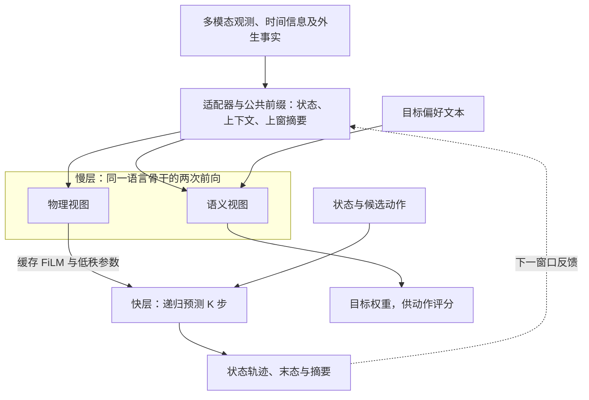

# MR-NWM 论文要点

核对日期：2026-10-29；新增规划代码依据：[0bc5801](https://github.com/xuda1979/6G-MR-NWM/tree/0bc5801544bf0fc9a466ce09a4e4c87181636a6b)。原论文指标保持原测量契约，以下区分设计方案、已实现接口与实验范围。

**MR-NWM 定位为 6G Agentic RAN 的世界模型组件：融合不同速率的网络观测，预测候选动作后的状态，供上层智能体比较方案。** 仓库包含语言基座路径、轻量合成参考模型，以及独立 LSTM 的真实数据观测预测。Agent Harness、RIC/E2 接口和实网控制闭环仍属后续工作，详见[中文技术报告](AGENTIC_RAN_TECHNICAL_REPORT_CN.md)。

## 1. 问题与方法

无线接入网（RAN）既要理解“提高吞吐、减少排队、节能”等目标，又要判断动作的物理后果。CSI、业务指标、图像和拓扑的采集周期各不相同；高频预测也难以承受每一步都调用大型语言模型的开销。

方案将计算分为慢、快两层：慢层用同一个预训练语言骨干的两个独立视图处理观测和偏好，分别产生物理调制参数与目标权重；快层缓存调制参数，结合状态、动作及递归记忆，连续预测 K 步。**固定初态、动作和外生条件时，改变偏好文字应保持物理预测不变；偏好通过动作选择影响实际未来。** 已发生的配置变化等事实需单独作为核实后的外生证据输入。

## 2. 模型输入、架构与输出

| 项目 | 表示与作用 | 实现边界 |
|---|---|---|
| 目标文本、外生事实 | 分词令牌，分字段输入 | 偏好只进入语义视图；事实真实性由调用者核实 |
| 状态、环境、历史摘要 | 连续数值投影 | 当前状态与上下文供物理预测使用 |
| CSI/IQ、KPI、拓扑、图像特征 | 各模态适配器生成连续 token，附类型、年龄、周期、有效掩码 | 复数拆分、射频校准、图像特征提取由外部完成；拓扑可聚合有效邻居 |
| 候选动作 | 数值动作序列 | 合成实验为两链路的归一化功率 |
| 物理输出 | `pred_states`，未来状态轨迹 | 合成参考默认 `[批量,K,6]`：两路增益、队列和干扰 |
| 语义与反馈输出 | `objective_weights`、`sync_summary` | 前者为吞吐/排队/能耗权重；后者连同预测末态供下一窗口使用 |

FiLM 是特征缩放与平移；动态低秩参数调整快层残差计算。慢层外围物理专家可与快层共享参数，该机制不改造语言 Transformer 内部层，也不等同于语言骨干 LoRA 微调。通用自然语言解释、任意协议动作生成仍待实现。

## 3. 多时间尺度怎样处理

| 时钟 | 处理方式 |
|---|---|
| 各模态采集周期 | 数据管线选择截至当前时刻的历史特征；每个 token 带观测年龄、周期与有效位 |
| 慢层刷新间隔 Δ_s | 融合不同年龄的观测，执行物理/语义两次前向，生成缓存调制包 |
| 快层步长 δ_f | 窗口内复用调制包执行 K 步；均匀物理步长时由调用者保证 Δ_s=K·δ_f |

例如慢层时刻 T，CSI、图像、拓扑分别已过去 1 ms、30 ms、800 ms，可以带着各自年龄一起融合。代码使用 `log(1+年龄)` 与 `log(1+周期)` 的嵌入，屏蔽缺失观测；配置 TTL 后也屏蔽过期观测及其图边，拒绝有效的未来观测。

跨窗口时，固定快照 `rollout` 按调用者提供的 `macro_period_seconds` 增加年龄；流式运行则由调用者传入新观测、重算年龄。两者均可传递预测末态与压缩摘要，完整快层记忆不直接跨窗。TTL 在慢层编码时检查；窗口内的新数据、过期事件及调度仍由外部管理。时钟同步、抗混叠、降采样和超长输入压缩也需外部管线；代码的 `resampler` 压缩快层隐藏特征以形成反馈摘要。详见[架构与时间处理](ARCHITECTURE_CN.md)。

## 4. 贡献与创新边界

贡献在于将多模态融合、偏好/动力学隔离、多速率缓存、可选物理专家共享和跨窗口反馈组成可检验的系统。跨窗口传递预测末态，避免反复使用真实初态掩盖累积误差；共享、调制、梯度消融及独立递归对照用于检验各机制的价值。

FiLM、低秩参数化和多速率递归已有研究基础。现有实验尚未证明参数共享、跨尺度梯度或语言预训练普遍优于强基线。轻量混合执行全部专家，未实现稀疏 MoE 加速。

## 5. 数据与主要结果

| 路径 | 已记录证据 | 可支持的范围 |
|---|---|---|
| 语言基座 `LanguageBasedWorldModel` | Qwen2.5-0.5B 的 CSI/IQ/拓扑接入、适配器梯度、偏好不变性检查 | 接口与梯度兼容；无线任务头尚未完成任务训练 |
| 轻量参考 `MultiRateNestedWorldModel` | 双链路合成系统，8 变体、3 种子、每个可训练模型 300 次更新 | 共享版 IID/OOD NMSE 为 −22.24±0.20 / −9.58±0.41 dB；不代表实网性能 |
| 真实数据 Stage-A | UC6：26,733 条记录；UCC 5G：83 会话、188,711 条记录；独立 19,344 参数 LSTM，3 种子 | 8 秒历史预测未来 4 秒 KPI，包含移动上下文；未评测语言基座或动作条件模型 |

Stage-A 的逐种子记录显示：UC6 吞吐、RTT、RSRQ 的 NMSE 相对持久性基线降低约 38%、43%、31%；UCC 5G 下行速率、RSRQ、SNR 降低约 11%、13%、9%。但不同指标并非同时改善：

| 任务 | LSTM MAE（均值±样本标准差） | 持久性 MAE |
|---|---:|---:|
| UC6 吞吐（Mbps） | 7.35±0.10 | 8.41 |
| UC6 RTT（ms） | 82.49±7.15 | 48.56 |
| UCC 5G 下行速率（kbps） | 32,198±336 | 29,328 |

两组实测任务的 RSRP 均差于持久性基线。这里 NMSE 为误差平方和除以目标能量；Stage-A 报线性比值，合成表报 dB，不能直接混比。三次种子运行的波动不是部署置信区间，UC6 记录还存在依赖版本差异。缺失 KPI 按完整轨迹段离线插值，也不能据此宣称严格在线因果预测性能。

上述实测数据没有无线控制动作日志，结果仅覆盖观测预测。当前没有实网资源优化收益或确定性亚毫秒时限证据。其他公开数据的模态、许可和任务映射见[真实数据集详表](REAL_DATASETS_CN.md)；跨数据集训练需分别定义任务，不能拼成虚假的同步轨迹。下一步重点是扩大模态与场景验证，并补齐真实动作或可控仿真的闭环证据。

### 5.1 新增有界规划与切片合成闭环

规划动作已独立整理为[动作设计](PLANNER_ACTIONS_CN.md)，代码提供数值动作规格、候选屏蔽、预算/整数/变化率检查、有界多步搜索及现有世界模型适配。原功率单步审计不变；新增两切片流体队列使用四维“预算＋模式”动作和独立合成状态，不能直接套用原六维功率模型作为已训练切片预测器。当前切片推演采用已知合成转移，未训练切片世界模型或 actor。

本地 181 项测试通过、1 项因缺少 UCC 原始数据跳过；原 24 组确定性检查点指标一致。四步演示记录 28 条合成转移，覆盖 20 种满预算资源/调度候选，并分别保存请求/实际动作、生效时间、持有期与共享场景分组。短程多步规划收益低于单步，当前只确认实现可运行，不宣称规划优势、实网迁移或 NPU/实时保证。命令、结果和验证清单见[实现说明](PLANNER_IMPLEMENTATION_CN.md)与[可追溯演示记录](../results/planner_smoke/summary.json)。

## 6. 来源与维护

- 方案：[论文](../paper/main.tex)、[语言架构章节](../paper/language_foundation.tex)、[Agentic RAN 报告](AGENTIC_RAN_TECHNICAL_REPORT_CN.md)。
- 实现：[语言基座](../src/mr_nwm/foundation.py)、[多模态适配器](../src/mr_nwm/modalities.py)、[参考模型](../src/mr_nwm/model.py)、[UC6](../src/mr_nwm/uc6.py)、[UCC 5G](../src/mr_nwm/ucc5g.py)。
- 证据：[合成结果](../results/SUMMARY.md)、[Qwen 接入记录](../results/pretrained_integration.json)、[UC6 逐种子与汇总](../results/uc6_stage_a/uc6_stage_a_results.json)、[UCC 5G 逐种子与汇总](../results/ucc5g_stage_a/ucc5g_stage_a_results.json)、[复现说明](REPRODUCIBILITY.md)。本次核对复算已记录指标，未重新训练或回放实测模型。

保持本文件为简要中文入口；论文结论、接口、架构、数据或验证结果变化时同步更新依据版本和相关段落。保留原始实验记录，将详细推导和操作步骤放在链接文档中。
