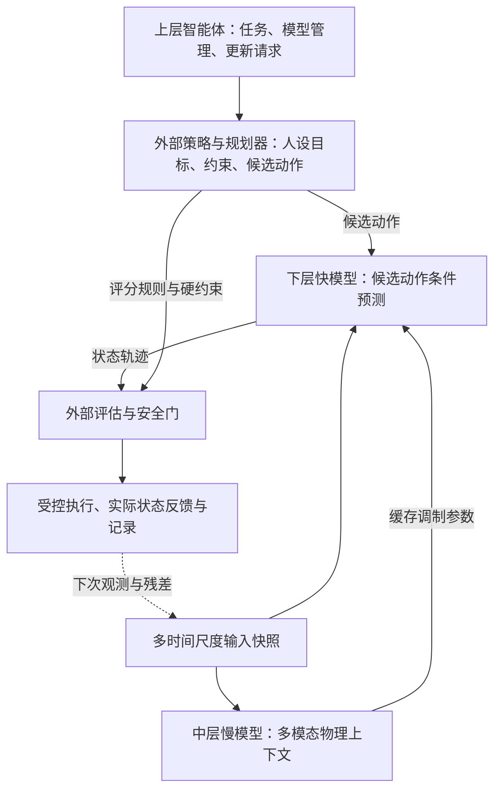

# 6G Agentic RAN 多时间尺度世界模型进展报告

**更新日期：** 2026年10月28日

**项目：** xuda1979/6G-MR-NWM

**核对基线：** [79ae31f](https://github.com/xuda1979/6G-MR-NWM/tree/79ae31f31570ffd029023d87ab6b04a28bf731c7)。本次更新核对模型、数据加载与训练代码，并从六份逐种子结果重算汇总；未重新训练或回放原始实测数据。沿用原报告文件路径，方便持续引用。

## 核心结论

1. **首要工程工作是把多时间尺度的数据组织好。** 建议以“按实体与模态分流的有界环形缓存、短时乱序整理、不可变输入快照、持久化 Episode”组成数据链路。模型已有年龄、周期和有效掩码接口；在线缓存、读写并发、时钟对齐和流式调度仍需开发。第 1 章给出字段、容量、读写、失效和具体数据例子。
2. **总体架构由上层智能体、中层慢模型和下层快模型分工协作。** 智能体管理任务和模型；慢模型融合较长时间跨度的多源物理上下文；快模型根据状态和候选动作预测未来。目标权重和硬约束由人或上层策略明确配置，动作选择交由规划器及安全门。
3. **慢模型具有值得检验的价值，也应保留可移除的实现路径。** 它可能改善多模态上下文融合、跨窗口记忆和重复计算开销；现有真实数据实验尚未证明这些收益。下一步将与真正跳过慢层的轻量基线进行同条件比较。
4. **真实数据预测已有可复核结果。** UC6 与 UCC 5G 合计 215,444 条原始记录，已记录独立轻量 LSTM 的三种子实验。UC6 的吞吐、RTT、RSRQ，以及 UCC 5G 的下行速率、RSRQ、SNR，其 NMSE 优于持久性基线；两组 RSRP 均较差，若干指标的 MAE 也变差。第 3 章完整列出数值和限制。
5. **公开数据仍缺完整训练链路。** 已盘点数据主要缺少与状态对齐的实际控制动作、快尺度连续反馈及同一场景的完整多模态与网络内部状态，限制动作条件模型、慢快联合训练和闭环收益验证；第 4 章逐项说明。
6. **近期按“数据底座—预测基线—慢层增益验证—动作闭环”推进。** 首先补齐时间跨度与因果预处理，再验证三层架构的增量收益，最后接入有动作记录的仿真或隔离测试床。当前结果支持观测预测研究，尚不支持实网资源优化收益或控制时限结论。

## 1. 多时间尺度的数据结构与流式处理

本章是下一阶段实现的首要依据。下面的缓存、快照和持久化结构属于**建议设计**；现有模型数据接口与离线 LSTM 窗口结构见 1.9，不能把建议结构视为已经上线的系统。

### 1.1 按数据含义划分存储，而不是把所有流拼成一张宽表

CSI/IQ、图像、网络 KPI、拓扑和配置具有不同速率、体积和有效期。建议用以下四类结构协同工作：

| 结构 | 分区键或索引 | 保存内容 | 主要用途 |
|---|---|---|---|
| 近期观测缓存 | `(episode_id, entity_id, modality, stream_id)` | 有界时间范围内的观测值、时间和质量字段；每路独立容量 | 持续写入，按模型决策时刻提取历史窗口 |
| 配置与拓扑版本表 | 实体、配置类型、版本、生效区间 | 功率配置、邻区关系、拓扑、模型兼容信息等 | 查询某一时刻实际生效的版本，支持历史回放 |
| 不可变输入快照 | `snapshot_id` | 本次推理实际使用的数据、年龄、掩码、版本及窗口边界 | 固定一次推理的输入，隔离后台写入与候选方案比较 |
| 持久化 Episode 与原始数据存储 | 来源文件/数据块、实体、时间范围、哈希 | 原始数据、特征、快照引用、预测、动作与反馈 | 离线训练、故障追踪和实验复现 |

环形缓存只保存近期数据；被覆盖的数据若需训练或审计，应先异步持久化。原始 IQ、视频、点云可写入分块文件或对象存储，缓存中保存块引用、有效区间和必要特征，避免把每个 IQ 采样点作为一个复杂对象存储。拓扑和配置需要版本及生效区间，不能只保留一个“当前值”。

### 1.2 一条观测需要哪些字段

建议统一观测封装，数值载荷仍按模态定义。字符串类型、单位和维度等公共信息可登记在流描述表，热缓存仅保存短标识以降低开销。

| 字段组 | 建议字段 | 具体作用 |
|---|---|---|
| 身份与关联 | `episode_id / entity_id / cell_id / stream_id / modality` | 防止不同小区、设备和实验轨迹的数据混合 |
| 唯一性与顺序 | `sample_id / source_sequence / ingest_sequence / cache_sequence` | 去重、检测缺号，分别记录源端、接收端和乱序整理后的缓存提交顺序 |
| 时间 | `event_time_ns / arrival_time_ns` | 分别表示测量发生时刻、数据到达接入端的时刻 |
| 统计区间 | `interval_start_ns / interval_end_ns` | KPI 或池化特征覆盖的时间范围；用区间结束时间确定其最早可用的物理时刻 |
| 时钟语义 | `clock_id / clock_mapping_version / time_uncertainty_ns` | 保留原始时钟与校正依据；不能将未校准的设备时间直接相减 |
| 采样与失效 | `period_ns / ttl_ns` 或配置中的等价字段 | 采样周期说明更新速度；TTL 是任务允许的最大观测年龄，两者独立 |
| 数值与质量 | `values / valid_mask / quality_flags` | 对每个字段保留缺失、异常、插补等信息；真实零值与缺失分开 |
| 数据定义 | `schema_version / unit_map / feature_version / normalization_version` | 防止单位、字段顺序和特征版本不兼容 |
| 来源 | `source_id / raw_ref / raw_hash` | 从特征追到原始文件或数据块；不强制每条样本重复计算大块哈希 |

时间建议用整数纳秒等固定单位存储，进入模型时再换算成秒。事件时间与到达时间应能映射到同一参考时钟；本地调度耗时可使用独立的单调时钟计量。对时误差超过任务容忍范围的流应单独处理或标记不可用于严格时间融合。

**建议观测记录示例**：下列是用于解释结构的虚构 KPI，时间相对本 Episode 的起点。它不属于 UC6/UCC 5G 原始记录，也不是已有采集器的接口。

```json
{
  "episode_id": "demo-001",
  "entity_id": "ue-07",
  "cell_id": "cell-A",
  "stream_id": "ue07-kpi",
  "modality": "kpi",
  "sample_id": "kpi-99",
  "source_sequence": 99,
  "ingest_sequence": 106,
  "event_time_ns": 9900000000,
  "arrival_time_ns": 9920000000,
  "interval_start_ns": 9800000000,
  "interval_end_ns": 9900000000,
  "clock_id": "episode-reference",
  "period_ns": 100000000,
  "ttl_ns": 500000000,
  "values": {
    "throughput_mbps": 82.0,
    "rtt_ms": 18.0,
    "rsrq_db": -10.5,
    "rsrp_dbm": -88.0
  },
  "valid_mask": [true, true, true, true],
  "quality_flags": [],
  "schema_version": "demo-kpi-v1",
  "feature_version": "demo-v1",
  "normalization_version": "training-stats-v1",
  "raw_ref": "episode/demo-001/kpi/block-0001"
}
```

### 1.3 环形缓存的组织、索引与容量

建议每个分区采用预分配数组：`values[C,d]`、`event_time[C]`、`arrival_time[C]`、`valid[C,d]`、`sequence[C]` 和必要的版本/引用字段，其中 C 是容量，d 是该流的特征维度。高频数值字段分列存储，便于批量复制为张量。

每次向主环提交时递增缓存序号 q，槽位可取 `q % C`。它与源端序号、到达时分配的接收序号分别记录，因为乱序整理会改变提交次序。槽位同时记录完整缓存序号；读取时核对序号，避免把绕回后新写入的数据误当成旧记录。不能只比较槽位下标。经乱序整理后，主环的逻辑记录按事件时间有序，按时间范围查找；物理数组绕回时可视为两段，分别检索后拼成连续的输入副本。

容量由历史保留时长、峰值速率、允许乱序时长和突发量共同确定：

$$
C_m \ge \left\lceil r_m^{\mathrm{peak}}(W_m+L_m)\right\rceil+B_m.
$$

其中 W 为需要保留的历史，L 为乱序容忍，B 为突发余量。下面仅为设计演示，具体参数需要按真实数据量和目标硬件测量确定。

| 流 | 示例速率 | 历史 W | 乱序余量 L | 突发余量 B | 最小容量与示例分配 |
|---|---:|---:|---:|---:|---|
| CSI 特征 | 1,000 条/秒 | 0.10 秒 | 0.01 秒 | 20 条 | 至少 130 条，可分配 256 槽 |
| KPI | 10 条/秒 | 5 秒 | 0.5 秒 | 10 条 | 至少 65 条，可分配 128 槽 |
| 图像特征 | 20 条/秒 | 1 秒 | 0.1 秒 | 4 条 | 至少 26 条，可分配 32 槽 |
| 拓扑/配置 | 事件触发或低频 | 按业务回放需求 | 按配置生效语义 | 单独设置 | 使用版本表；近期引用可另设有界缓存 |

例如，每条 CSI 特征有 64 个 float32 值，数值占 256 字节；若固定元数据预算另为 64 字节，256 槽约占 80 KiB。这只是容量估算，未计字符串、索引、数据块、快照副本和分配器开销。原始高采样率 IQ 的内存预算必须按采样率、复数精度、天线数及保留时长另算。

**历史保留期与有效期分别管理。** 保留 100 ms 的 CSI 可服务历史建模和回放；若本次任务要求最新 CSI 年龄不超过 5 ms，仍需检查该条件。不能因为记录还在缓存中就认为可供当前控制使用。

### 1.4 写入、乱序、重复与背压

建议每个分区采用单写者。多个采集任务先进入有界接入队列，由同一写入任务校验、去重和提交，减少共享数组的并发竞争。

1. **校验后接收。** 检查实体、字段、单位、时钟映射和有限数值；为每个有效字段保留质量状态。未知版本不静默转成有效数据。
2. **短时乱序先整理。** 可用按事件时间排序的小顶堆，暂存允许乱序范围内的记录，再向时间有序缓存提交；相同时间戳允许有不同样本，去重应依赖来源与样本 ID。
3. **定义水位线与迟到策略。** 每流用最大已见事件时间减允许乱序量形成候选水位线，并结合心跳或流状态判断进度。水位线表示容忍假设，不能证明以后绝无迟到数据。早于主环已提交事件时间的迟到记录不直接追加到时间有序主环，而进入旁路日志或独立迟到索引；是否用于后续快照仍按事件时间、到达截止和 TTL 过滤。已冻结的快照不回写。
4. **明确容量耗尽行为。** 超时消费者、接入队列满或持久化积压时，执行已配置的降采样、拒收或丢弃策略，累计丢失计数；不得把丢数据伪装为正常连续采样。
5. **先记录，再发布。** 写入完整载荷和元数据后才发布序号/边界，使读取方不会取得半条记录。初版可使用短锁完成提交；无锁实现需另外验证内存可见性与覆盖行为。

### 1.5 读取与快照：后台继续写，当前预测输入保持不变

在决策参考时刻 T 生成快照，同时冻结本次数据可用性的到达截止时刻 A。演示中取 A=T；真实部署需明确采集、决策与执行截止时间。候选输入至少满足：

$$
t^{\mathrm{event}} \le T,\qquad
t^{\mathrm{arrival}} \le A,\qquad
\mathrm{age}=T-t^{\mathrm{event}}\ge0.
$$

还需核对实体、版本、质量和任务配置的 TTL。统计量的事件时间使用统计区间结束时刻，其覆盖区间也必须截止于 T。

乱序整理与数据新鲜度需要共同考虑。若 CSI 允许年龄只有 5 ms，而水位线落后 10 ms，仅读取已提交主环会漏掉最新有效数据。建议提供两种快照策略：

- **优先新鲜度：**短锁内同时复制主环、待整理堆和允许使用的迟到索引，按本次 T/A 筛选、去重和排序。它使用当时已到达的数据，快照需标记时间窗口可能仍不完整。
- **优先时间完整性：**将输入截止限制在各必需流已确认的水位线，或仅在等待预算内等候；同时检查观测年龄。不能无限等待所有流，也不能通过等待获得已过期数据的有效性。

快照应记录采用的策略及各流进度。初版读取流程如下：

1. 捕获各流已提交的序号边界、待整理/迟到记录的可读集合和配置版本；按所选策略确定数据范围。
2. 在短锁内选取并复制所需记录为推理私有副本；释放锁后再做较重的特征提取与张量编码。
3. 为快照登记 ID、T/A、各流来源序号、窗口边界、缺失率、观测年龄、预处理及归一化版本。
4. 从同一快照为多个候选动作建立独立预测状态和递归记忆。候选 A 的末态不能成为候选 B 的初态。
5. 直到本次预测完成，快照值和版本不变；后续新数据只影响下一次快照。

仅保存环形数组的内存视图不足以保证一致性：后台写入可能覆盖旧槽。后续若改为零拷贝，需增加数据块引用计数或固定页保留、代际校验和容量耗尽处理。初版优先采用可验证的复制快照，再依据实测瓶颈优化。

### 1.6 不同速率数据如何进入同一次推理：具体例子

假设 T=A=10.000 s。下列数值、周期及 TTL 均为算法说明，不代表已验证的无线系统时限。

| 模态 | 示例内容 | 事件时间 | 到达时间 | 在 T 的年龄 | 本次处理 |
|---|---|---:|---:|---:|---|
| CSI 特征 | 两路复信道拆成实部/虚部：`[0.80,0.05,0.60,-0.02]` | 9.999 s | 9.9996 s | 1 ms | 已到达；若 TTL=5 ms，则有效 |
| 图像特征 | 由外部视觉编码器得到的连续向量 | 9.970 s | 9.995 s | 30 ms | 若 TTL=100 ms，则有效 |
| KPI | 82 Mbps、18 ms、−10.5 dB、−88 dBm | 9.900 s | 9.920 s | 100 ms | 若 TTL=500 ms，则有效 |
| 拓扑 | 邻区关系版本 v7 | 9.200 s | 9.250 s | 800 ms | 核对生效区间与版本，必要时再检查最大年龄 |
| 迟到 CSI | 另一条合法 CSI | 9.998 s | 10.004 s | 事件上已有 2 ms | 尚未到达，排除本次快照 |
| 时钟异常数据 | 被标记为有效的未来事件 | 10.002 s | 9.999 s | −2 ms | 隔离并核查时钟，不作为有效观测 |

每个模态按自身需求取一个尾随历史窗口，保留若干原始特征或因果摘要，再转换为 `values[B,N_m,d_m]`。模型接收的年龄为 `age_seconds[B,N_m]`，并附采集周期及有效掩码。

高频数据可先按尾随区间做统计或特征压缩；降采样需考虑抗混叠。KPI 与拓扑保留自身速率及真实年龄，无需复制到每个 CSI 采样时刻。不同数据集、不同日期或不相关实体不能仅按行号拼成同步轨迹。

**未来预测与实时刷新分别处理。** 在 T 生成快照后，模型可以一次计算未来多步的假设轨迹；若 10.020 s 要根据新测量重新作出真实动作决策，就必须由调度器重新检查观测与上下文是否仍有效。5 ms 的 CSI 有效条件不能由一个 100 ms 的缓存窗口自动保证。

### 1.7 模型输入、上下文缓存和长期记录各存什么

| 对象 | 核心内容 | 更新与隔离方式 |
|---|---|---|
| `ObservationSnapshot` | 各模态值、年龄、周期、掩码；状态、实体、来源和版本 | 每次决策冻结；原始观测与预测值分开标记 |
| `ContextPacket` | `gamma / beta / lora_a / lora_b`、环境上下文；建议附 ContextID、快照/模型版本和适用条件 | 慢层刷新时生成新版本；适用性检查由外部调度层落实 |
| `PolicyConfig` | 人设目标权重、硬约束、目标范围和 PolicyID | 策略变化时独立更新，避免把偏好当作物理测量 |
| `PredictionRecord` | 快照、模型/上下文版本、候选动作、预测时域及状态轨迹 | 每个候选独立记录；不写回“已观测”缓存 |
| `ActionFeedback` | 请求动作、实际生效动作、生效时间、执行状态和后续测量 | 执行确认后追加，用于残差、动作条件训练和回放 |
| Episode 存储 | 上述对象的关联、原始引用和校验值 | 追加写入并定期校验；训练划分按完整会话/轨迹等实体隔离 |

ContextID/PolicyID 生命周期和完整持久化链路是后续系统设计，当前模型只返回内部张量与摘要，不能宣称已有跨节点缓存协议。

### 1.8 正确性要求和首批验收用例

数据结构的价值要由可测行为验证。首批用例应覆盖：

- **环形绕回与并发：**多次覆盖后仍能返回正确时间范围；消费者读到的数据不被后台写入改动，不出现撕裂记录。
- **迟到与重复：**乱序输入、重复 ID、同时间不同样本、缺号和迟到超限都有确定结果及计数。
- **因果可见性：**未来事件或尚未到达的数据不进入当次快照；快照生成后新增数据不改变原决策。
- **缺失与过期：**按字段掩码，缺失不当作零值；TTL、版本或必需模态条件不满足时标记不可用并调用已配置回退。
- **版本与来源：**单位/维度/归一化版本不兼容时拒绝；跨小区或跨 Episode 数据不能误配。
- **资源边界：**在预设峰值输入率下测量内存上限、丢失率和快照耗时分布；不能仅凭均值声称满足时限。
- **回放一致性：**同一快照、模型、动作、策略和评测配置能重现同一计算输入；随机推理需保存随机源。
- **在线预处理：**仅允许使用当时已到达的历史，比较离线插值与因果版本，记录由此产生的结果变化。

### 1.9 仓库已实现的数据结构与待开发项

| 项目 | 当前实现 | 下一步 |
|---|---|---|
| 模态观测 | `ModalityObservation`：`values / age_seconds / period_seconds / valid / adjacency / max_age_seconds` | 由采集层补齐源时间、到达时间、实体、版本及原始引用 |
| 多模态编码 | 数值投影、类型与时间嵌入、有效/过期掩码；可选拓扑消息传递 | 对接真实 RF 校准、视觉/点云编码与历史选取 |
| 慢层输入 | `FoundationInputs`：目标文本、模态字典、可选已核实外生事实文本 | 从冻结快照构造输入；为来源和时钟建立可追溯映射 |
| 离线 LSTM 窗口 | `UC6Windows / UCC5GWindows`：历史、未来、上下文、观测掩码、会话/片段 ID、划分及归一化统计 | 保留既有实验协议，新增严格物理时间与因果预处理版本 |
| 多窗口预测 | `rollout` 推进固定观测快照的年龄，传递预测末态与摘要 | 在线流由外部逐窗口重新传入；还需实现数据采集、缓存和调度 |
| 环形缓存与流式运行 | 尚无完整实现 | 有界接入、乱序整理、读写快照、容量告警与持久化回放 |

当前 `TypedModalityEncoder` 将 `log(1+age)` 和 `log(1+period)` 编码进特征；`max_age_seconds` 配置后会屏蔽过期 token。模型不会自动维护时间索引、等待新数据、缩减超长输入或在每个快步重新检查 TTL。模型中的 `resampler` 压缩快层隐藏特征，原始传感器重采样另由数据管线承担。

## 2. 上层智能体、中层慢模型、下层快模型的架构与价值

### 2.1 三层职责和外部执行链路



| 层次 | 输入例子 | 输出例子 | 更新/调用边界 |
|---|---|---|---|
| 上层智能体 | “优先保障业务时延”；人设权重与约束；模型能力、网络告警、执行反馈 | 结构化任务、PolicyID、工具调用、模型选择和刷新/重规划请求 | 任务变化、异常或监督周期触发；完整 Harness 仍待实现 |
| 中层慢模型 | 冻结快照、当前状态、环境、上窗摘要和已核实外生事实 | 物理上下文与快层调制包；语义路径当前还输出目标权重 | 每个宏窗口或后续事件刷新；现有代码包含慢层路径 |
| 下层快模型 | 当前/上一预测状态、该步候选动作、缓存上下文和窗口内递归记忆 | 下一状态及隐藏特征；K 步组成状态轨迹和摘要 | 单次调用内部递推 K 步；预测输出不直接构成动作优化 |
| 外部规划/安全/执行 | 候选轨迹、人设策略、明确约束、接口状态 | 选中的动作、拒绝原因、实际生效值及反馈 | 有限候选评分已有合成参考；完整实网执行仍待接入 |

参考任务默认六维状态为两路信道增益、两路队列和两路干扰；动作是两路归一化功率，K=5。吞吐、时延等新输出需要相应任务定义或评价计算；不能把当前六维预测直接描述为已有的真实 5G KPI 输出头。

### 2.2 中层慢模型具体做什么

语言基座路径 `LanguageBasedWorldModel` 对同一个预训练语言 Transformer 执行两次前向：

- **物理视图：**接收状态、环境、上窗摘要、多模态 token 及已核实外生事实，形成物理上下文，不接收目标偏好文字。
- **语义视图：**在公共输入后追加目标偏好文本，供目标头处理。目标改变可影响候选评分；固定物理条件和候选动作时，物理预测应保持不变。

物理上下文经过调制头输出 `gamma / beta` 和低秩因子 `lora_a / lora_b`，供快层在一个窗口内复用。默认宽度 32、低秩 2 时，批量 B 下两组向量形状均为 `[B,32]`，两组低秩因子均为 `[B,32,2]`。它们是本次输入生成的运行时条件。共享参数选项只关联慢层外围物理专家与快层物理核心，未把语言 Transformer 内部整体改成快模型；当前两次语言前向也没有共享前缀 KV 缓存。

需要区分三类“权重”：

| 类型 | 谁决定/生成 | 何时更新 |
|---|---|---|
| 吞吐、时延、能耗等目标权重 | 人或上层策略明确设定；自然语言解析只能提供可核验的结构化建议 | 业务策略变化时 |
| 神经网络训练参数 | 根据训练目标和数据进行学习 | 离线训练或受控再训练/微调时 |
| `gamma / beta` 与动态低秩因子 | 慢模型由物理输入生成 | 慢层上下文刷新时 |

当前代码仍有学习式 `objective_weights` 输出头。本报告建议增加显式人设策略输入及固定策略路径；该接口尚未在本次文档更新中修改。无论采用何种解析方式，硬约束始终由外部确定性检查落实。

### 2.3 慢模型的价值、成本及保留条件

| 价值假设 | 具体作用 | 当前证据与后续验证 |
|---|---|---|
| 融合多模态和不同年龄的观测 | 将 CSI、拓扑、移动/环境等信息综合成紧凑条件，减少快模型直接处理长输入的负担 | 年龄/掩码与适配接口已有代码；真实无线任务上的收益待训练验证 |
| 表达跨窗口环境变化 | 将上窗隐藏摘要和新的观测结合，帮助描述较长依赖或外生变化 | 末态与摘要反馈已实现；需与只输入短历史的小模型比较 |
| 复用较昂贵的上下文计算 | 一个慢层结果支持 K 步快预测或同一快照下多个兼容候选 | 结构上可复用；需测量预处理、双语言前向、候选数量与快层的总成本 |
| 利用预训练表征 | 尝试迁移多模态/语义理解能力，降低不同场景的适配难度 | 已有语言基座接入检查；没有建立其无线任务普遍优于轻量模型的结论 |

一个窗口的计算成本约为 `C_预处理 + C_慢层 + K·C_快层`。复用可减少“每一步重新调用完整慢层”的成本；与完全省去慢层的小模型比较时，仍要支付慢层开销。不能仅根据大小模型分工就声称系统一定更快或更准确。

因此保留两条可比较路线：**轻量预测器直接工作**，以及**慢层上下文加快预测器**。当数据维度较低、任务单一、历史较短时，先采用轻量路径；当跨模态、跨场景、较长依赖的优势经实验证明且成本可接受时，再保留慢层。智能体的任务管理功能可独立配置。

现有 `modulation=False` 消融仅关闭调制效果，仍会计算慢层；后续需要单独实现真正跳过慢层的基线，才能比较完整开销和增量收益。

### 2.4 慢快模型如何调用、如何刷新

以 K=5、预测步长 20 ms、宏窗口 100 ms 为说明。**这些是调用者设定的物理时间标签，未经过目标无线设备验证；当前代码在一次 forward 内立即循环计算五步，不会自动每隔 20 ms 调用一次。**

| 阶段 | 数据/调用 | 发生的更新 |
|---|---|---|
| T=10.000 s 构造输入 | 从 1.6 的缓存生成固定快照，准备初态、环境和五步候选功率 | 新建 `FoundationInputs`；保存输入来源及策略版本 |
| 慢层调用 | `forward_slow_tier(inputs, state, context, previous_summary)` | 生成本窗口调制包；语言基座路径内部有物理/语义两次前向 |
| 快层第 1 步 | `forward_fast_tier_step(state, action_1, packet, memory=None)` | 预测 T+20 ms 状态，建立递归记忆 |
| 快层第 2–5 步 | 每步用上一步预测状态、新候选动作、同一 packet 和当前记忆 | 得到 T+40、60、80、100 ms 的假设状态 |
| 窗口结束 | 压缩五步隐藏特征形成 `sync_summary` | 返回 `pred_states[B,5,6]` 与摘要；此时未自动执行任何动作 |
| T=10.100 s 新决策 | 外部调度装入新观测、重算年龄/掩码、检查版本并调用下一窗口 | 在线可用真实状态估计修正初态；自由滚动评测则延续预测末态；传入上一摘要 |

常规 `model(inputs, state, actions, context, previous_summary)` 已在内部串起一次慢层与 K 次快层。每次 forward 的快层递归记忆重新开始，跨窗口传递的是状态与压缩摘要；完整快层记忆不会自动跨窗延续。

现有 `rollout` 处理固定观测快照，通过 `advance` 增加年龄，不会从缓存读入未来新测量。流式更新必须由外部逐窗口重建输入。运行时刷新上下文与模型参数训练分别进行，推理调用不等于在线学习；当前 TTL 检查在慢层编码时发生，快步中的实时过期与回退仍需调度层实现。

### 2.5 三层架构的当前成熟度

语言基座路径已有多模态接口、两种视图、慢到快调制与跨窗反馈；轻量参考路径在合成双链路任务上有对照实验。上层 Agent Harness、在线缓存/调度、ContextID 生命周期、完整安全执行与真实动作闭环仍待开发。

UC6/UCC 5G 的 LSTM 结果属于独立观测预测基线，未训练或验证上述完整三层组合。两种数据都缺少功率、PRB、波束等控制动作日志，当前不能据其结果判断候选无线动作的因果效果。

## 3. UC6、UCC 5G 的 LSTM 预测实验与详细结果

### 3.1 数据来源、规模与任务

| 项目 | 5G-IANA UC6 | UCC 5G production |
|---|---|---|
| 数据含义 | Nokia 边缘服务器与车载 OBU 间的真实测量；不能由此默认具有运营商商用网控制日志 | 爱尔兰科克市商用 5G/LTE 手机路测，单运营商 B；仅使用 production 数据 |
| 原始规模 | 26,733 条记录 | 83 个 CSV 会话，188,711 条记录 |
| 当前分段结果 | 96 段，其中 52 段进入窗口构造 | 94 个可用片段，会话内分段 |
| 训练 / 验证 / 测试窗口 | 16,312 / 3,639 / 6,149 | 115,367 / 44,396 / 27,912 |
| 预测目标顺序 | 吞吐 Mbps、RTT ms、RSRQ dB、RSRP dBm | 下行速率 kbps、RSRP dBm、RSRQ dB、SNR dB |
| 输入 | 8 个历史记录点的 4 项 KPI，加 5 维移动上下文 | 同样的窗口形状，按本数据的四项目标定义 |
| 输出 | 未来 4 个记录点的 4 项 KPI | 未来 4 个记录点的 4 项 KPI |
| 动作日志 | 无 | 无 |

两组共 215,444 条原始记录。滑动窗口存在组内重叠，窗口数不能解读成同等数量的独立实验轨迹。

代码以 `history=8 / horizon=4` 按记录索引切窗；数据名义为秒级，但本次检查没有看到统一按物理时间重建规则网格的步骤，UC6 还存在同一秒多条观测。因此，本报告以“8 个历史点预测 4 个未来点”为严格口径，固定 8 秒/4 秒的跨度需重新核验。统计窗口和代码名义设置不能直接换算成毫秒级控制能力。

### 3.2 模型、训练和数据处理协议

LSTM 输入是 `[B,8,4]` 的标准化 KPI 历史，单层隐藏宽度 64。末时刻隐藏向量加上 5 维移动上下文的线性投影，经过 SiLU，再由线性解码器一次输出 `[B,4,4]`。移动上下文为历史窗口内的纬度、经度、航向正弦/余弦及估计速度均值；没有输入无线控制动作。

| 项目 | 已记录设置 |
|---|---|
| 参数量 | 每个模型 19,344；两组数据分别训练模型，未记录跨数据集零样本迁移实验 |
| 训练预算 | 每种子 2,000 次优化更新，批量 128 |
| 优化器 | 当前脚本为 Adam，默认学习率 0.001；结果元数据未完整记录学习率等全部解析参数，下一轮需补齐 |
| 随机种子 | 11、22、33 |
| 损失 | 标准化目标的平方误差，按未来目标有效掩码计分；UC6 代码对全缺失目标批次另有回退分支，后续需统计触发情况 |
| 基线 | 持久性：将历史最后一个 KPI 值重复四次 |
| 划分 | UC6 按完整可用轨迹段的时间顺序，UCC 按完整会话的时间顺序，名义比例 70/15/15；先分组再生成窗口 |
| 归一化 | 从训练窗口拟合统计量，验证/测试复用；当前统计按窗口加权，重叠记录可能被重复计入 |
| 缺失处理 | 保存原始观测掩码，段内对 KPI 进行线性插值；评分仅使用真实观测的未来目标位置 |
| 当前掩码输入边界 | 历史掩码随窗口保存，但当前 LSTM forward 只接收数值历史与移动上下文，未显式输入年龄和历史缺失掩码 |
| 运行记录 | UC6 记录在 NPU，既有说明为 Ascend 910B；UCC 在 CPU。主机、框架和依赖不同，训练耗时不作硬件性能比较 |

分组隔离避免把同一会话的重叠窗口随机分到训练和测试。**段内插值可能使用该预测时刻之后的观测值**；位置清洗也使用片段级信息，因此现有预处理不能直接宣称严格在线因果。下一轮应保留既有协议，另建只使用当时可见历史的版本，重新评测。

### 3.3 指标定义与重算口径

以下均为现存逐种子 JSON 记录的重算；未新跑模型。MAE/RMSE/NMSE 越低越好。误差在反归一化之后计算，未来四步及有效测试窗口合并计分：

$$
\mathrm{MAE}=\frac{1}{N}\sum_i|\hat y_i-y_i|,\quad
\mathrm{RMSE}=\sqrt{\frac{1}{N}\sum_i(\hat y_i-y_i)^2},\quad
\mathrm{NMSE}=\frac{\sum_i(\hat y_i-y_i)^2}{\sum_i y_i^2}.
$$

这里 NMSE 的分母是目标的原始数值能量，未减去均值，不能解释为按目标波动方差归一化；RSRP 等带较大直流偏移的目标尤其应结合绝对误差阅读。改善率取 `100×(1−LSTM均值/基线)`，正值表示误差降低，负值表示变差。

“±”表示三次记录的样本标准差，基线在三种子间相同。UC6 的种子 22 与另两次记录使用不同 Python/PyTorch/NumPy 版本，因此其波动还包含环境差异，不能全部归因于初始化，更不能作为部署置信区间。以下汇总也没有分预测步长、分场景或分尾部给出结论。

### 3.4 UC6：全部目标的结果

| 预测目标 | LSTM MAE：均值 ± 标准差 | LSTM RMSE：均值 ± 标准差 | LSTM NMSE：均值 ± 标准差 |
|---|---:|---:|---:|
| 吞吐量（Mbps） | 7.35 ± 0.10 | 9.99 ± 0.04 | 0.114244 ± 0.001025 |
| RTT（ms） | 82.49 ± 7.15 | 282.13 ± 1.54 | 0.807419 ± 0.008777 |
| RSRQ（dB） | 0.48 ± 0.02 | 0.99 ± 0.01 | 0.007207 ± 0.000184 |
| RSRP（dBm） | 3.38 ± 0.44 | 4.29 ± 0.54 | 0.001576 ± 0.000407 |

测量单位为 Mbps、ms、dB、dBm；RSRP 的 MAE/RMSE 表示信号功率的 dB 差值。其余误差单位与对应测量单位一致，NMSE 为线性比值。

| 预测目标 | 持久性 MAE | 持久性 RMSE | 持久性 NMSE | NMSE 改善率 | MAE 改善率 |
|---|---:|---:|---:|---:|---:|
| 吞吐量（Mbps） | 8.41 | 12.68 | 0.183949 | +37.89% | +12.60% |
| RTT（ms） | 48.56 | 372.42 | 1.406824 | +42.61% | -69.86% |
| RSRQ（dB） | 0.34 | 1.19 | 0.010423 | +30.86% | -40.35% |
| RSRP（dBm） | 2.40 | 3.53 | 0.001060 | -48.75% | -40.61% |

**结果解读：**

- 吞吐是当前最一致的改进项：NMSE 降低 37.89%，MAE 降低 12.60%，RMSE 也较低。
- RTT 的 NMSE 降低 42.61%，但 MAE 从 48.56 ms 升至 82.49 ms，恶化 69.86%；不能据平方误差改善宣称时延保障更好。
- RSRQ 的 NMSE 降低 30.86%，但 MAE 恶化 40.35%，提示需要按业务可接受误差及分位数重新评估。
- RSRP 的 NMSE 恶化 48.75%，MAE、RMSE 同样较差。对于数秒内较平稳的信号指标，“保持最后观测值”是必须保留的强基线；当前结果尚不能证明具体失败机制。

### 3.5 UCC 5G：全部目标的结果

| 预测目标 | LSTM MAE：均值 ± 标准差 | LSTM RMSE：均值 ± 标准差 | LSTM NMSE：均值 ± 标准差 |
|---|---:|---:|---:|
| 下行速率（kbps） | 32198.30 ± 335.99 | 56548.84 ± 1568.14 | 0.432061 ± 0.023882 |
| RSRP（dBm） | 3.75 ± 0.38 | 5.93 ± 0.75 | 0.004214 ± 0.001024 |
| RSRQ（dB） | 1.55 ± 0.03 | 2.02 ± 0.03 | 0.022316 ± 0.000564 |
| SNR（dB） | 3.51 ± 0.04 | 4.86 ± 0.05 | 0.476965 ± 0.010752 |

下行速率单位为 kbps；例如 LSTM 的下行 MAE 约 32.20 Mbps，持久性约 29.33 Mbps。RSRP 的绝对误差按 dB 差值理解。两组数据的吞吐单位不同，不能将表中数字直接横向比较。

| 预测目标 | 持久性 MAE | 持久性 RMSE | 持久性 NMSE | NMSE 改善率 | MAE 改善率 |
|---|---:|---:|---:|---:|---:|
| 下行速率（kbps） | 29328.44 | 59945.56 | 0.485276 | +10.97% | -9.79% |
| RSRP（dBm） | 1.34 | 2.66 | 0.000841 | -401.24% | -180.10% |
| RSRQ（dB） | 1.47 | 2.17 | 0.025634 | +12.94% | -5.65% |
| SNR（dB） | 3.20 | 5.09 | 0.521428 | +8.53% | -9.45% |

**结果解读：**

- 下行速率、RSRQ、SNR 的 NMSE 分别降低 10.97%、12.94%、8.53%，但三个目标的 MAE 分别恶化 9.78%、5.65%、9.45%。
- RSRP 的 NMSE 约为基线的 5.01 倍，恶化 401.24%；三个误差指标均较差，需要重点排查目标动态、偏置、归一化和损失选择。
- 两组数据重复出现“部分平方误差改善、绝对误差并未同步改善，以及 RSRP 较差”的模式；这为选择损失和任务基线提供了线索，尚不是模型普遍优越的证据。

### 3.6 逐种子 NMSE 与结果来源

| 数据集/目标 | 种子 11 | 种子 22 | 种子 33 | 持久性 |
|---|---:|---:|---:|---:|
| UC6 / 吞吐量（Mbps） | 0.114388 | 0.113154 | 0.115189 | 0.183949 |
| UC6 / RTT（ms） | 0.813253 | 0.811680 | 0.797325 | 1.406824 |
| UC6 / RSRQ（dB） | 0.007156 | 0.007411 | 0.007053 | 0.010423 |
| UC6 / RSRP（dBm） | 0.001417 | 0.002039 | 0.001273 | 0.001060 |
| UCC 5G / 下行速率（kbps） | 0.406756 | 0.454206 | 0.435220 | 0.485276 |
| UCC 5G / RSRP（dBm） | 0.004648 | 0.003045 | 0.004950 | 0.000841 |
| UCC 5G / RSRQ（dB） | 0.022855 | 0.021729 | 0.022365 | 0.025634 |
| UCC 5G / SNR（dB） | 0.476710 | 0.487843 | 0.466343 | 0.521428 |

逐种子 MAE、RMSE、运行环境及完整参数元数据见：

- UC6：[种子 11](../results/uc6_stage_a/box_runs/seed11_uc6_results.json)、[种子 22](../results/uc6_stage_a/box_runs/seed22_uc6_results.json)、[种子 33](../results/uc6_stage_a/box_runs/seed33_uc6_results.json)、[汇总](../results/uc6_stage_a/uc6_stage_a_results.json)。
- UCC 5G：[种子 11](../results/ucc5g_stage_a/box_runs/seed11_ucc5g_results.json)、[种子 22](../results/ucc5g_stage_a/box_runs/seed22_ucc5g_results.json)、[种子 33](../results/ucc5g_stage_a/box_runs/seed33_ucc5g_results.json)、[汇总](../results/ucc5g_stage_a/ucc5g_stage_a_results.json)。

UC6 汇总文件顶层 `arguments.seeds` 沿用了单种子参数，完整三次运行应以 `seeds / per_seed` 和逐种子文件为准；本次只在报告中说明，保留原实验记录。

### 3.7 当前结果能支持什么、还缺什么

现有结果证明已记录一条可在两类真实测量上运行的“读取—分段—窗口—LSTM—基线评分”流程，并暴露了按指标评估与强基线比较的重要性。它们尚未证明语言基座、慢快调制、多模态同步融合或真实动作优化有效。

后续复现仍需补齐：

1. 逐窗口/逐步预测、目标及掩码，按真实物理时间计算的预测跨度分布和错误分位数。
2. LSTM checkpoint、完整解析配置、运行代码哈希、数据/划分清单、驱动及加速器依赖版本；现有入库结果 JSON 不足以完整回放训练和评分。
3. 统一环境下的重跑与更强基线，包括逐目标持久性、线性/自回归及适用的轻量时序模型；统一预算比较。
4. 严格因果的数据处理、缺失/过期与跨会话泛化评测；在有动作数据后另行评价控制收益。

## 4. 公开数据缺口与训练受阻环节

本章的判断范围是[仓库已盘点的 8 项/组公开真实数据](REAL_DATASETS_CN.md)，其中仅 UC6、UCC 5G 已接入 Stage-A。它们能够支持部分观测预测与表示学习；完整的动作条件世界模型和慢快联合训练仍缺少关键数据。尚未下载或逐字段核验的候选保留为待确认，不能概括为所有公开数据都不具备相关字段。

### 4.1 缺少什么，具体阻碍哪一步

| 数据缺口 | 当前证据与范围 | 受阻的训练/验证 | 可先做的工作 |
|---|---|---|---|
| **时间对齐的实际动作与生效结果** | 已接入两组 KPI 没有功率、PRB、波束等实际控制动作、执行确认和生效时间；其他候选尚未确认具备本项目完整动作链路 | 难以训练和验证“给定动作会怎样”的世界模型、候选动作排序与真实闭环收益 | 继续无动作观测预测；在可控仿真中记录已施加动作和反馈，再取受控实测轨迹校准 |
| **匹配快层目标时域的连续测量** | 当前两组为名义秒级记录，含重复时间戳/间断；没有建立与示例 20 ms 步长对应的状态—动作—反馈序列 | 不能从秒级 KPI 训练结果推出毫秒级无线状态预测与控制能力 | 先按真实时间核验秒级任务；针对选定快层场景收集足够分辨率的同步数据 |
| **同一 Episode 的完整多模态对应关系** | DeepSense 在部分场景有配对感知和无线观测；UC6/UCC 没有同场景的原始 CSI/IQ、图像和点云；不同数据源实体、地点和时间不同 | 无法直接训练覆盖所有模态、所有时间尺度的统一慢层，并检验其跨模态信息价值 | 按来源分别预训练适配器/任务头；选一个原生配对场景做慢层融合实验，跨数据集采用独立任务 |
| **支撑选定动作的网络状态与外生因素** | 已接入的终端 KPI 没有完整提供邻区耦合、队列、业务到达量、调度与实际资源配置；现有候选未核验齐备 | 增加状态不可观测与混杂，限制长时预测、跨场景迁移及动作效果判断 | 为首个功率/干扰场景明确必需状态，补齐邻区、实际功率和负载等必要字段；不要求一次收齐所有无线量 |
| **独立测量的业务后果** | UC6 有端到端 RTT，UCC 的 PING 大量缺失；两者未建立本项目所需的 RAN 排队时延、尾部 QoS 与能耗标签链路 | 无法据现有目标直接训练/验证所有吞吐—时延—能耗评价，不能把 RTT 等同于 RAN 队列时延 | 按已有真实标签定义任务；补业务反馈和能耗测量；目标权重由人配置，无需等待数据集提供偏好权重标签 |
| **足够的独立场景与动作覆盖** | 原始行与滑动窗口高度相关；现有实验只有两组数据，未形成多运营商、多小区、故障、突变等场景的分层覆盖证据 | 限制跨场景泛化、异常恢复及安全回退结论；样本多不代表动作和环境覆盖充分 | 建立场景清单和按会话/设备等隔离的评估；分开报告未覆盖、正常与受控扰动场景 |
| **数据版本、许可和获取信息的一致性** | 候选的下载/许可确认程度不同，部分有非商业限制或授权待复核；6 项候选尚未用于本仓库训练 | 限制合法可用的训练集合和可重复获取，增加任务适配工作 | 固定具体版本、条款和来源；先接入权限明确且任务匹配的子集，不将候选清单计为已训练数据 |

动作记录是重要前提，但仅有动作列也不能自动证明因果效应：还需记录行为策略、可选动作范围与外生条件，检查动作覆盖和混杂；必要时采用受控实验设计。缺失动作不能填零后当作真实“零功率动作”。

### 4.2 八项候选分别适合补什么、还缺什么

| 数据源 | 可利用的信息 | 对完整 MR-NWM 的主要不足/待核验点 |
|---|---|---|
| DeepSense 6G | 部分场景的波束功率、相机、GPS、雷达、LiDAR 配对信息 | 模态组合因场景而异；最优波束标签不等于实际施加的波束动作；缺少本项目所需完整队列/资源/动作反馈链路，尚未接入训练 |
| DICHASUS | 实测 CSI 与位置；可做信道表征、定位，连续片段可评估时序预测 | 需区分空间扫描与自然运动时序；未确认本项目的调度、队列和干预动作；尚未接入 |
| UCC 5G | 商用网终端 KPI、位置与移动信息；已有观测预测基线 | 无动作日志；PING 缺失严重；秒级记录无法直接监督毫秒级快层；不包含同场景的完整多模态传感器流 |
| Lumos5G | 商用毫米波吞吐与用户上下文候选 | 尚未完成全包接入与许可复核；未确认完整动作干预和网络内部状态 |
| 5G-IANA UC6 | 吞吐、端到端 RTT、信号质量与位置；已有基线 | 无动作日志；重复时间戳、信号指标缺失和轨迹异常需处理；RTT 与 RAN 排队时延含义不同 |
| 5G-IANA Nokia 路测 | 位置、上下行吞吐、PING | 199 个独立轨迹点，三份 KML 内容重复，仅样式不同；规模小、间隔不均匀，适合加载/缺失处理验证 |
| Telecom Italia Milan | 10 分钟粒度业务活动与空间信息 | 活动强度不等于吞吐、PRB 或能耗；网格不等于基站拓扑；与其他地点的快尺度数据没有天然同步关系 |
| WiSig | 真实 WiFi IQ 与设备/接收机/日期标签 | 主要支持射频表征/指纹任务；包与日期不能视为连续蜂窝控制轨迹，接收机间同步及任务迁移需另验 |

**仍可推进的训练与受阻范围需要区分。** 两组 KPI 的轻量预测可以继续改进；CSI/IQ 表征和配对多模态波束任务可以逐一接入。完整慢快模型的联合训练、跨时间尺度物理状态演进，以及动作优化效果验证，需要更符合目标场景的数据包。

此外，当前插值可能使用未来观测、按行号切窗、历史掩码未作为 LSTM 输入、环境与实验清单不完整等问题，属于**本仓库的数据管线和实验记录缺口**，应优先自行修复。RSRP 和部分 MAE 退化仍需排查模型、损失、预处理与分布因素，不能全部归因于公开数据不足。

### 4.3 首个动作闭环所需的最小数据包

建议先选“两个或少量小区的功率与干扰协调”作为明确场景，再规定必需字段及可选字段。每个 Episode 至少关联：

1. **运行头信息：**拓扑/实体、模型及预处理版本、频段与单位、时钟映射、行为策略及允许动作范围。
2. **每步可见观测：**事件时间、到达时间、必要信道/干扰状态、实际功率、负载或队列及质量/缺失信息；字段由动作预测所需的可观测性决定。
3. **请求与实际动作：**候选/请求动作、实际生效值、生效时刻、成功/拒绝/超时状态，防止用未执行请求替代真实动作。
4. **后续独立反馈：**与动作时间对应的吞吐、队列/时延、干扰；只有纳入能耗目标时才必须增加可核验的能耗测量。
5. **轨迹和覆盖信息：**会话/实验组、移动和业务变化、异常事件、可用动作覆盖，以及训练/验证/测试归属。

先用可控仿真生成此结构、检验代码和评估协议，再在隔离实验网获取小规模真实同步轨迹。模拟、人工注入延迟和实测字段分别标记；不把仿真或派生标签写成真实设备测量。

### 4.4 对开发顺序的影响

优先解决可自行推进的时间与因果预处理，保留已经能做的 KPI 预测；并行选择一个具有原生多模态配对的数据场景。随后取得具备状态、已施加动作及反馈的数据，验证动作条件快模型，再判断慢层融合是否提供增益。完整动作日志和配对多模态的缺口主要限制后两步，不应成为停止所有训练工作的理由。


## 5. 下一步开发计划

按阶段验收推进，后续阶段依赖前一阶段证据；以下为开发计划，不是已完成结果或固定时间承诺。

| 优先级/阶段 | 主要工作与交付物 | 验收条件 | 依赖 |
|---|---|---|---|
| **P0：统一时间与实验口径** | 冻结数据版本和会话划分；统计重复/乱序时间戳、间隔与窗口跨度；完整保存配置、代码/数据哈希、checkpoint 和逐点预测；新增因果预处理协议 | 每个窗口可追到原始记录及物理跨度；训练/测试组隔离可自动检查；相同记录能独立复算全部表格；旧结果保留且不与新协议混用 | 当前记录和原始数据权限 |
| **P1：实现多时间尺度数据底座** | 按 1 章实现统一观测封装、分区环形缓存、乱序整理、配置版本表、复制快照及持久化回放；建立 `ObservationSnapshot → FoundationInputs` 适配 | 1.8 的正确性用例通过；内存有界；丢失/迟到/覆盖可见；在约定峰值负载下记录快照延迟分位数与吞吐 | P0 的时钟与字段定义 |
| **P2：改进真实数据轻量基线** | 在 UC6/UCC 上统一运行环境；先保持目标和划分，对比因果处理、掩码/年龄输入、残差预测、MAE/Huber 等损失；对 RSRP 单独保留持久性回退 | 固定主指标及 MAE/尾部等保护指标；按 1–4 个未来点及物理时间分别报告；性能变差的目标明确拒绝升级；验证集选择，测试集作最终评估 | P0；P1 支持流式验证 |
| **P3：验证慢模型的增量价值** | 增加真正无慢层路径；比较轻量单模型、小型慢上下文+快模型、预训练慢层+快模型；先训练适配器/任务头，再评估是否微调骨干；补人设 PolicyConfig 接口 | 可见观测、划分、时域和候选相同，记录参数/训练及推理预算；报告跨场景/缺失/过期表现与端到端时延。只有增益稳定且成本符合预先约定预算时保留慢层 | P1/P2 和适用的多模态配对数据 |
| **P4：建立智能体与动作仿真闭环** | 先定义有界工具和任务配置，再接规划器、安全门、ContextID/PolicyID、更新/失效/回退及动作确认；生成观测—已施加动作—后续状态的同步 Episode | 各候选隔离；固定动作下目标改变不污染物理预测；过期/超域/失败触发确定行为；对比规则控制和适用优化基线，分别报告控制收益与计算成本 | P1–P3 的可用组件及可控仿真 |
| **P5：扩展数据与隔离测试床** | 按许可和任务选择 DeepSense、CSI/IQ 等候选数据，先完成特征与时间映射；闭环通过后接真实遥测，逐步从只读/建议模式进入有界动作试验 | 模态、实体和物理时间可对应；无动作数据只报告预测/表征；目标硬件完成采集到执行的完整时延、故障恢复和回放核验后再决定扩大试验 | 有效的数据/设备接口与前序验收 |

### 5.1 最先应形成的可交付版本

近期最小可交付版本由三部分组成：

1. **能连续写、稳定读、可回放的数据缓存与快照模块。** 先通过 UC6/UCC 离线回放模拟异步到达、延迟、乱序和缺失；人为注入的到达时间或延迟必须标为受控实验条件。
2. **一份统一环境和因果数据协议下的 LSTM/强基线报告。** 完整保存模型及逐点结果，重点解决 RSRP 和 MAE 退化，不先扩大模型规模。
3. **一套慢层可插拔的评估接口。** 在真正无慢层的基线上量化慢层增益与额外开销；智能体只管理已声明能力的模型与工具。

### 5.2 资源与协作需求

- 数据工程需要确认各源的时钟、单位、实体、版本、实际采样间隔与许可，并维护快照/回放链路。
- 模型研究需要冻结评测协议、补齐强基线和残差分析，再决定适配器、慢模型和动作条件模型的训练规模。
- 系统工程需要提供目标负载、时限预算、可用硬件和受控接口，验证并发读写、超时与回退。
- 无线业务侧需要明确允许动作、硬约束、效用目标与可接受误差，提供实际生效配置及时间对齐的遥测。

每一阶段先以有限样本和小规模资源验证，再根据证据扩大；模型、数据和预算变化需要形成新的可追溯实验版本。

## 6. 本阶段工作的价值与当前边界

**数据工程价值：**统一不同速率、不同年龄和不同来源的数据，降低错配、未来信息泄漏与重复取数风险，使预测输入能够复核。该工作同时支撑轻量模型和未来多模态模型，具有较强复用性。

**模型研究价值：**将“慢层是否必要”转成有基线、有消融、有资源成本的实验问题。真实数据结果已经提示指标选择与持久性基线的重要性，便于把训练资源集中在确有提升空间的任务。

**系统价值：**把任务管理、物理预测、策略评分和安全执行分开，支持替换模型、追踪实际动作及定义失败行为；多时间尺度缓存和快照为该系统提供共同数据基础。

**研究与标准化价值：**已形成 Agentic RAN 架构、多时间尺度处理、上下文适用条件和反馈语义的材料，可支持后续接口分析、可复现实验与提案研究。当前材料属于研究设计，未证明标准采纳、跨厂商互通、专利新颖性或标准必要性。

当前最值得投入的工作，是把数据结构与因果时间链路做成可运行模块，并用完整真实数据基线验证预测能力，再判断慢模型和智能体组合能带来多大增益。

## 参考与证据入口

- [模型架构和时间处理](ARCHITECTURE_CN.md)、[Agentic RAN 中文技术报告](AGENTIC_RAN_TECHNICAL_REPORT_CN.md)、[论文要点](OVERVIEW_CN.md)。
- [数据集与许可清单](REAL_DATASETS_CN.md)、[复现说明](REPRODUCIBILITY.md)、[实验运行说明](EXPERIMENT_RUNS.md)。
- 数据/模型代码：[modalities.py](../src/mr_nwm/modalities.py)、[foundation.py](../src/mr_nwm/foundation.py)、[model.py](../src/mr_nwm/model.py)、[uc6.py](../src/mr_nwm/uc6.py)、[ucc5g.py](../src/mr_nwm/ucc5g.py)。
- LSTM 训练与评分：[train_uc6.py](../scripts/train_uc6.py)、[train_ucc5g.py](../scripts/train_ucc5g.py)。
- 历史合成基准：[结果摘要](../results/SUMMARY.md)。与本报告的独立真实数据 LSTM 任务分开解读。
